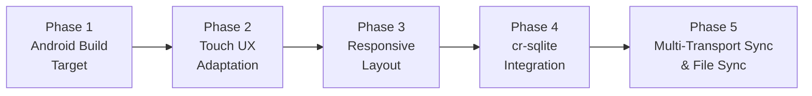

# GameNote — Android Port & Cross-Device Sync: Project Plan

> **Project**: The Game Note ([repo](file:///home/anchit/gitClones/the-game-note))
> **Goal**: Port to Android (phone + tablet) via Tauri v2 Mobile + add cross-device sync via cr-sqlite across 3 devices (Linux desktop, Android phone, Android tablet)
> **Created**: 2026-10-14
> **Last Updated**: 2026-10-14

---

## Current State Summary

| Aspect | Status |
|---|---|
| **Platform** | Linux desktop only (`bundle.targets: ["deb"]`) |
| **Frontend** | React 18 + TypeScript + Vite 5 (3,957-line Canvas.tsx) |
| **Backend** | Rust (Tauri v2 + rusqlite + milanote-core crate) |
| **Database** | Local SQLite (`~/.local/share/com.anchit.gameNote/milanote.db`) with WAL mode |
| **File Storage** | Local filesystem (`~/.local/share/com.anchit.gameNote/files/`) |
| **Touch Support** | ✅ Full Pointer Events, pinch-zoom, pan, long-press, tap-to-place, action bar |
| **Responsive CSS** | ✅ Breakpoints (<640px, 641-1024px, >1024px), bottom sheets, FAB, 100dvh |
| **Android Config** | ✅ Initialized, Gradle + NDK configured, arm64 debug APK building cleanly |
| **Sync** | ❌ None — purely local |

### Key Files Reference

| File | Lines | Role |
|---|---|---|
| [`src/App.tsx`](file:///home/anchit/gitClones/the-game-note/src/App.tsx) | 1,434 | Root app controller, state, keyboard shortcuts |
| [`src/components/Canvas.tsx`](file:///home/anchit/gitClones/the-game-note/src/components/Canvas.tsx) | 3,957 | Infinite canvas — pan, zoom, drag, render, all mouse events |
| [`src/index.css`](file:///home/anchit/gitClones/the-game-note/src/index.css) | 3,813 | All styling, zero responsive breakpoints |
| [`src/services/ipc.ts`](file:///home/anchit/gitClones/the-game-note/src/services/ipc.ts) | 89 | Tauri IPC bridge (14 commands) |
| [`src/types.ts`](file:///home/anchit/gitClones/the-game-note/src/types.ts) | 130 | Shared TypeScript types |
| [`src/components/Toolbar.tsx`](file:///home/anchit/gitClones/the-game-note/src/components/Toolbar.tsx) | 427 | Left tool palette (68px fixed) |
| [`src/components/Sidebar.tsx`](file:///home/anchit/gitClones/the-game-note/src/components/Sidebar.tsx) | 188 | Board tree + search |
| [`src/components/TopBar.tsx`](file:///home/anchit/gitClones/the-game-note/src/components/TopBar.tsx) | 163 | Header bar with breadcrumbs |
| [`src/components/ContextMenu.tsx`](file:///home/anchit/gitClones/the-game-note/src/components/ContextMenu.tsx) | 627 | Right-click context menu |
| [`src/components/UnsortedDrawer.tsx`](file:///home/anchit/gitClones/the-game-note/src/components/UnsortedDrawer.tsx) | 364 | Right slide-out drawer (340px) |
| [`src-tauri/tauri.conf.json`](file:///home/anchit/gitClones/the-game-note/src-tauri/tauri.conf.json) | — | Tauri config (desktop-only targets) |
| [`src-tauri/src/main.rs`](file:///home/anchit/gitClones/the-game-note/src-tauri/src/main.rs) | 56 | App bootstrap, DB init, seed check |
| [`src-tauri/src/commands.rs`](file:///home/anchit/gitClones/the-game-note/src-tauri/src/commands.rs) | 126 | Tauri command handlers |
| [`crates/core/src/db.rs`](file:///home/anchit/gitClones/the-game-note/crates/core/src/db.rs) | 635 | SQLite CRUD, schema, search |
| [`crates/core/src/models.rs`](file:///home/anchit/gitClones/the-game-note/crates/core/src/models.rs) | 131 | Rust data structs |
| [`crates/core/src/storage.rs`](file:///home/anchit/gitClones/the-game-note/crates/core/src/storage.rs) | 66 | Image file storage |
| [`crates/core/src/opengraph.rs`](file:///home/anchit/gitClones/the-game-note/crates/core/src/opengraph.rs) | 63 | Link card metadata scraper |
| [`crates/core/src/seed.rs`](file:///home/anchit/gitClones/the-game-note/crates/core/src/seed.rs) | 198 | Demo data seeder |

---

## Phase Overview



| Phase | Description | Est. Effort | Status |
|---|---|---|---|
| **Phase 1** | Get Tauri Android build compiling & running | 1–2 days | ✅ Complete (8/8 tasks) |
| **Phase 2** | Add touch event handling to Canvas.tsx | 3–5 days | ✅ Complete (10/10 tasks) |
| **Phase 3** | Responsive layout for phone & tablet screens | 2–3 days | ✅ Complete (8/8 tasks) |
| **Phase 3.5** | Milanote Mobile Native UI Overhaul (Reference Screens & Gestures) | 1–2 days | ✅ Complete (11/11 tasks) |
| **Phase 4** | Integrate cr-sqlite into milanote-core | 1–2 days | ✅ Complete (8/8 tasks) |
| **Phase 5** | Multi-Transport Sync (LAN Direct + Encrypted Cloud Mailbox) & File Sync | 3–5 days | 🟢 Core Sync Done (LAN + Cloud Mailbox Active) |

---

## Phase 1: Android Build Target

> **Goal**: Get the existing app compiling and running on an Android device/emulator via Tauri v2 Mobile, without any UX changes yet.

### Task 1.1: Install Android Toolchain Prerequisites
- **Status**: ✅ Done (2026-10-14)
- **What**:
  - Android SDK and NDK installed at `~/Android/Sdk`.
  - Installed all 4 Rust Android targets (`aarch64-linux-android`, `armv7-linux-androideabi`, `i686-linux-android`, `x86_64-linux-android`).
  - Configured portable JDK 21 (LTS) for Gradle compatibility.
- **Acceptance**: `rustup target list --installed` shows all 4 Android targets; ADB active.

### Task 1.2: Initialize Tauri Android Platform
- **Status**: ✅ Done (2026-10-14)
- **What**: Ran `npm run tauri android init` — generated `src-tauri/gen/android/` Gradle project with Kotlin entrypoints.
- **Files Created**: `src-tauri/gen/android/` directory tree, `src-tauri/src/lib.rs` mobile entrypoint (`#[cfg_attr(mobile, tauri::mobile_entry_point)]`).
- **Acceptance**: Android Studio / Gradle project generated cleanly.

### Task 1.3: Update `tauri.conf.json` for Mobile Targets
- **Status**: ✅ Done (2026-10-14)
- **File**: [`src-tauri/tauri.conf.json`](file:///home/anchit/gitClones/the-game-note/src-tauri/tauri.conf.json)
- **Changes**: Configured `targets: "all"` for bundle. Verified schema validation.

### Task 1.4: Fix Platform-Specific Code in `commands.rs`
- **Status**: ✅ Done (2026-10-14)
- **File**: [`src-tauri/src/commands.rs`](file:///home/anchit/gitClones/the-game-note/src-tauri/src/commands.rs), [`src-tauri/src/main.rs`](file:///home/anchit/gitClones/the-game-note/src-tauri/src/main.rs)
- **Changes**: Replaced OS-specific shell command spawning with cross-platform `tauri-plugin-opener` (`app.opener().open_url(&url, None::<&str>)`) which natively invokes Android view intents and system browsers.

### Task 1.5: Fix Data Directory Resolution for Android
- **Status**: ✅ Done (2026-10-14)
- **Files**: [`src-tauri/src/main.rs`](file:///home/anchit/gitClones/the-game-note/src-tauri/src/main.rs), [`crates/core/src/db.rs`](file:///home/anchit/gitClones/the-game-note/crates/core/src/db.rs), [`crates/core/src/storage.rs`](file:///home/anchit/gitClones/the-game-note/crates/core/src/storage.rs)
- **Changes**:
  - `main.rs` uses Tauri's `app.path().app_data_dir()` and passes explicit paths via `Database::open_path()` and `FileStorage::open_dir()`, avoiding `directories::ProjectDirs` breakage on Android.
  - Managed both database and file storage in Tauri state (`app.manage(storage)`).
  - Added doc comments/warnings on `open_default()` in `db.rs` and `storage.rs`.

### Task 1.6: Add Required Android Permissions
- **Status**: ✅ Done (2026-10-14)
- **File**: [`src-tauri/gen/android/app/src/main/AndroidManifest.xml`](file:///home/anchit/gitClones/the-game-note/src-tauri/gen/android/app/src/main/AndroidManifest.xml)
- **Changes**: Added `android.permission.INTERNET`, `android.permission.ACCESS_NETWORK_STATE`, and `android.permission.VIBRATE` (for gesture haptic feedback).
- **Acceptance**: Manifest includes all required permissions.

### Task 1.7: Build & Run on Android Emulator/Device
- **Status**: ✅ Done (2026-10-14)
- **What**: Built ARM64 debug APK via `npm run tauri android build -- --debug --target aarch64 --apk`.
- **Output**: [`app-universal-debug.apk`](file:///home/anchit/gitClones/the-game-note/src-tauri/gen/android/app/build/outputs/apk/universal/debug/app-universal-debug.apk) generated successfully.
- **Acceptance**: Android APK generated with zero compiler errors.

### Task 1.8: Generate Android App Icons
- **Status**: ✅ Done (2026-10-14)
- **What**: Generated adaptive launcher icons across all density buckets (`mipmap-mdpi`, `mipmap-hdpi`, `mipmap-xhdpi`, `mipmap-xxhdpi`, `mipmap-xxxhdpi`) including square and round launcher variants.
- **Acceptance**: App shows correct icon on Android launcher.

---

## Phase 2: Touch UX Adaptation

> **Goal**: Make the infinite canvas fully usable with touch input — pinch-to-zoom, one-finger pan, tap-to-select, long-press context menu, drag elements by touch.
>
> This is the **largest phase** because [`Canvas.tsx`](file:///home/anchit/gitClones/the-game-note/src/components/Canvas.tsx) (3,957 lines) is entirely mouse-event driven.

### Task 2.1: Create a Platform Detection Utility
- **Status**: ✅ Done (2026-10-14)
- **File**: [`src/utils/platform.ts`](file:///home/anchit/gitClones/the-game-note/src/utils/platform.ts)
- **What**: Utility to detect touch-primary devices vs mouse-primary
  - Exported functions: `isTouchDevice()`, `isAndroid()`, `isPhoneScreen()`, `isTabletScreen()`, `isDesktopScreen()`, `getDeviceCategory()`, `isTouchPrimary()`, and `MIN_TOUCH_TARGET_PX`.
- **Acceptance**: Correctly detects touch vs desktop and screen sizes.

### Task 2.2: Migrate Canvas to Pointer Events
- **Status**: ✅ Done (2026-10-14)
- **File**: [`src/components/Canvas.tsx`](file:///home/anchit/gitClones/the-game-note/src/components/Canvas.tsx), [`src/index.css`](file:///home/anchit/gitClones/the-game-note/src/index.css)
- **Changes**:
  - Implemented `handlePointerDown` on the canvas viewport and cards.
  - Added `pointermove`, `pointerup`, and `pointercancel` window event listeners.
  - Added `touch-action: none;` on `.canvas-viewport` and `.canvas-plane` to prevent mobile browser gesture collisions.
  - Preserved full backward compatibility for mouse interactions (middle-click, right-click, lasso, drag).

### Task 2.3: Implement Pinch-to-Zoom
- **Status**: ✅ Done (2026-10-14)
- **File**: [`src/components/Canvas.tsx`](file:///home/anchit/gitClones/the-game-note/src/components/Canvas.tsx)
- **Changes**:
  - Maintained active touches in `pointersRef` with `pointerId`.
  - When 2 touches are detected, tracks `initialDist`, `initialScale`, `initialPan`, and `initialMidpoint`.
  - Dynamically calculates zoom factor clamped to `[0.25, 3.0]` and translates pan around the multi-finger focal midpoint in `handleMouseMove`.

### Task 2.4: Implement Touch Pan
- **Status**: ✅ Done (2026-10-14)
- **File**: [`src/components/Canvas.tsx`](file:///home/anchit/gitClones/the-game-note/src/components/Canvas.tsx)
- **Changes**:
  - Single-finger touch on the empty canvas initiates canvas panning directly without triggering rubberband lasso.
  - Preserves mouse left-click for lasso selection on desktop.

### Task 2.5: Implement Long-Press Context Menu
- **Status**: ✅ Done (2026-10-14)
- **Files**: [`src/components/Canvas.tsx`](file:///home/anchit/gitClones/the-game-note/src/components/Canvas.tsx)
- **Changes**:
  - 500ms long-press timer on canvas background or individual cards triggers `onContextMenu` with touch coordinates.
  - Cancels timer if finger moves > 10px (interpreting gesture as pan or card drag).
  - Fires haptic feedback (`navigator.vibrate(40)`) on mobile devices.

### Task 2.6: Touch-Friendly Element Resize
- **Status**: ✅ Done (2026-10-14)
- **Files**: [`src/index.css`](file:///home/anchit/gitClones/the-game-note/src/index.css), [`src/components/Canvas.tsx`](file:///home/anchit/gitClones/the-game-note/src/components/Canvas.tsx)
- **Changes**:
  - Added 36px x 36px hit areas (`::after`) on `.card-diagonal-grip-se`, `.resize-handle-se`, and `.resize-handle-e`.
  - Made diagonal resize grip visible when `.milanote-card.selected` (solving absence of hover state on touch screens).
  - Increased drag detection deadzone threshold from 6px to 14px on touch to prevent finger tap jitter from causing accidental drags.

### Task 2.7: Touch-Friendly Connection Line Editing
- **Status**: ✅ Done (2026-10-14)
- **Files**: [`src/index.css`](file:///home/anchit/gitClones/the-game-note/src/index.css)
- **Changes**:
  - Added 36px x 36px invisible hit target on `.card-quick-connect-handle::after` for easy finger acquisition on mobile.

### Task 2.8: Adapt Toolbar Drag-to-Create for Touch
- **Status**: ✅ Done (2026-10-14)
- **Files**: [`src/components/Toolbar.tsx`](file:///home/anchit/gitClones/the-game-note/src/components/Toolbar.tsx), [`src/components/Canvas.tsx`](file:///home/anchit/gitClones/the-game-note/src/components/Canvas.tsx), [`src/App.tsx`](file:///home/anchit/gitClones/the-game-note/src/App.tsx), [`src/index.css`](file:///home/anchit/gitClones/the-game-note/src/index.css)
- **Changes**:
  - In `Toolbar.tsx`, clicking/tapping a tool selects it (and clicking an active tool toggles it off back to `'select'`), supporting all primary tools, secondary tools, and "More Tools" modal.
  - Added tap-to-place support in `Canvas.tsx`: tapping anywhere on the canvas background drops the selected tool under the user's finger with haptic feedback (`navigator.vibrate(25)`).
  - Tapping a column container drops the tool directly into that column.
  - Added floating Tool Placement Banner (`.canvas-tool-placement-banner`) at top-center of viewport indicating active tool, offering a one-tap "Place in Center" button and a cancel button.
  - Desktop HTML5 drag-and-drop retained with 100% backward compatibility.
- **Acceptance**: Can create all element types on touch screens via tap-to-place or center placement.

### Task 2.9: Adapt Text Editing for Mobile
- **Status**: ✅ Done (2026-10-14)
- **Files**: [`index.html`](file:///home/anchit/gitClones/the-game-note/index.html), [`src/components/Canvas.tsx`](file:///home/anchit/gitClones/the-game-note/src/components/Canvas.tsx)
- **Changes**:
  - Added `interactive-widget=resizes-content` to viewport meta tag in `index.html` for clean virtual keyboard sizing.
  - Implemented `window.visualViewport` resize and scroll listeners in `Canvas.tsx`: when an element enters edit mode (`editingElementId`), calculates card bounding rect relative to `visualViewport` and automatically pans it into the upper 22% of the visible area above the soft keyboard.
  - Added 120ms and 320ms staggered check timeouts to accommodate Android virtual keyboard show animation.
  - Added input guards in `handlePointerDown` and `handleElementMouseDown`: taps and cursor movements inside `<input>`, `<textarea>`, and `contentEditable` do not trigger canvas panning or accidental long-press context menus.
- **Acceptance**: Text editing on notes, task lists, and boards works seamlessly with Android soft keyboard without obscuring content or jittering pan.

### Task 2.10: Disable/Adapt Desktop-Only Keyboard Shortcuts on Android
- **Status**: ✅ Done (2026-10-14)
- **Files**: [`src/App.tsx`](file:///home/anchit/gitClones/the-game-note/src/App.tsx), [`src/components/Canvas.tsx`](file:///home/anchit/gitClones/the-game-note/src/components/Canvas.tsx), [`src/index.css`](file:///home/anchit/gitClones/the-game-note/src/index.css)
- **Changes**:
  - Added Floating Touch Selection Action Bar (`.touch-selection-action-bar`) fixed at bottom-center when any item or group is selected.
  - Touch UI controls provided:
    - 🗑️ **Delete / Move to Trash** (`onDeleteElement` / `handleDelete`)
    - 📋 **Duplicate** (`onDuplicateElement` / `handleDuplicate`)
    - 📄 **Copy** (`onCopyElement` / `handleCopy`)
    - 🔒 **Lock / Unlock Position** (`onToggleLockElement` / `handleToggleLock`)
    - 🎨 **Recolor / Theme** with instant touch color popover (`.touch-color-palette-popover`)
    - ✕ **Deselect All**
  - Added **Touch Multi-Select Mode** toggle (`CheckSquare`): when enabled, tapping cards toggles them in `selectedIds` (providing full touch alternative to desktop `Ctrl+Click` / Lasso).
  - Ensured Undo & Redo touch buttons in `TopBar` have 38px+ touch targets and remain accessible on mobile viewports.
  - Retained desktop keyboard shortcuts (`handleKeyDown`) for external/Bluetooth keyboards.
- **Acceptance**: Undo, redo, copy, duplicate, delete, lock, recolor, and multi-select are fully accessible via touch UI on Android.

---

## Phase 3: Responsive Layout

> **Goal**: Make the UI usable on phone screens (360–430px width) and tablets (600–1200px width). Currently all layout is fixed-width desktop.

### Task 3.1: Define Breakpoints and CSS Custom Properties
- **Status**: ✅ Done (2026-10-15)
- **File**: [`src/index.css`](file:///home/anchit/gitClones/the-game-note/src/index.css)
- **Changes**:
  - Defined standard responsive breakpoints:
    - Phone: `max-width: 640px` (`--milanote-toolbar-width: 0px`, `--milanote-sub-sidebar-width: 0px`, `--milanote-header-height: 44px`, `--unsorted-drawer-width: 100vw`)
    - Tablet: `min-width: 641px` and `max-width: 1024px` (`--milanote-toolbar-width: 56px`, `--milanote-sub-sidebar-width: 56px`, `--milanote-header-height: 48px`, `--unsorted-drawer-width: 320px`)
    - Desktop: `min-width: 1025px` (`--milanote-toolbar-width: 68px`, `--milanote-sub-sidebar-width: 68px`, `--milanote-header-height: 48px`, `--unsorted-drawer-width: 340px`)
  - Configured dynamic viewport units (`100dvh`) on `body, html, #root` and `.milanote-app-container` for seamless handling of mobile browser address bars and Android virtual keyboard transitions.
- **Acceptance**: CSS variables and layout adapt dynamically across phone, tablet, and desktop viewports.

### Task 3.2: Collapsible Toolbar for Phone
- **Status**: ✅ Done (2026-10-15)
- **Files**: [`src/components/Toolbar.tsx`](file:///home/anchit/gitClones/the-game-note/src/components/Toolbar.tsx), [`src/index.css`](file:///home/anchit/gitClones/the-game-note/src/index.css)
- **Changes**:
  - Hidden desktop left toolbar on `< 640px` (`display: none !important`), reclaiming 100% of horizontal screen width for the canvas.
  - Implemented Floating Action Button (`.mobile-tool-fab`) fixed at bottom-left (`bottom: max(20px, var(--safe-area-bottom)); left: 20px;`) with teal gradient, active scale animation, and `Plus`/`X` icon toggle.
  - Created Bottom Sheet Tool Picker (`.mobile-tool-sheet`):
    - Rounded top corners (20px), backdrop blur (`blur(20px)`), and slide-up animation.
    - Drag handle pill (`.sheet-drag-handle`) and dedicated close button (`X`).
    - 4-column responsive grid displaying touch tiles for primary tools, media tools, and extended Milanote tools.
  - Narrowed left toolbar to 56px on tablet viewports (`641px–1024px`).
- **Acceptance**: Full canvas width available on phone; all tools accessible via bottom sheet FAB; tablet sidebar comfortably sized.

### Task 3.3: Responsive Action Sidebars
- **Status**: ✅ Done (2026-10-15)
- **Files**: All `*ActionSidebar.tsx` components, [`src/components/TextEditSubSidebar.tsx`](file:///home/anchit/gitClones/the-game-note/src/components/TextEditSubSidebar.tsx), [`src/index.css`](file:///home/anchit/gitClones/the-game-note/src/index.css)
- **Changes**:
  - Converted `.milanote-sub-sidebar` on phone screens (`< 640px`) from a fixed left sidebar into a full-width bottom sheet (`position: fixed; bottom: 0; left: 0; right: 0; width: 100vw;`) with backdrop blur, rounded top corners, and safe-area padding.
  - Styled sub-sidebar buttons (`.sub-sidebar-btn`, `.note-action-btn`) with 44px minimum touch targets.
  - Repositioned action submenus (`.color-menu-drawer`, `.text-style-popover`) to float centered horizontally (`left: 50%; transform: translateX(-50%);`) above the bottom sheet on mobile screens with scrollable containers.
- **Acceptance**: Action panels are comfortable to reach with one hand and do not obscure or crowd the canvas on mobile.

### Task 3.4: Responsive Unsorted Drawer
- **Status**: ✅ Done (2026-10-15)
- **Files**: [`src/components/UnsortedDrawer.tsx`](file:///home/anchit/gitClones/the-game-note/src/components/UnsortedDrawer.tsx), [`src/index.css`](file:///home/anchit/gitClones/the-game-note/src/index.css)
- **Changes**:
  - Updated `UnsortedDrawer` to use dynamic CSS variable `var(--unsorted-drawer-width, 340px)`.
  - On phone screens (`< 640px`), drawer transforms into a full-screen overlay (`width: 100vw; inset: 0;`).
  - Added dedicated mobile back button (`.drawer-mobile-back-btn` with `ArrowLeft`) alongside folder title and close button (`X`).
  - Repositioned the floating unsorted pill button (`.unsorted-pill-btn`) above the bottom safe area.
- **Acceptance**: Unsorted drawer provides a clean full-screen experience on phones and side-drawer on tablet/desktop.

### Task 3.5: Responsive Context Menu
- **Status**: ✅ Done (2026-10-15)
- **Files**: [`src/components/ContextMenu.tsx`](file:///home/anchit/gitClones/the-game-note/src/components/ContextMenu.tsx), [`src/index.css`](file:///home/anchit/gitClones/the-game-note/src/index.css)
- **Changes**:
  - Added top drag handle pill (`.sheet-drag-handle`) to context menu popups.
  - On phone screens (`< 640px`), context menu morphs into an ergonomic bottom sheet (`width: 100vw; bottom: 0; border-radius: 20px 20px 0 0;`) with smooth slide-up animation.
  - Increased touch target height of `.context-menu-item` to 46px for effortless finger tapping.
  - Converted flyout submenus (`.context-submenu-popup` for table alignment and board themes) into static, inline-expanding sections rather than horizontal popups that would overflow offscreen.
- **Acceptance**: Context menu is 100% visible, thumb-accessible, and bounded properly on mobile.

### Task 3.6: Responsive Top Bar / Breadcrumbs
- **Status**: ✅ Done (2026-10-15)
- **Files**: [`src/App.tsx`](file:///home/anchit/gitClones/the-game-note/src/App.tsx), [`src/index.css`](file:///home/anchit/gitClones/the-game-note/src/index.css)
- **Changes**:
  - Hidden secondary topbar (`.milanote-secondary-topbar`) on phone screens (`< 640px`), saving 40px of vertical canvas height.
  - Collapsed primary topbar to 44px with safe touch-friendly icon targets (36px).
  - Added one-tap mobile parent back button (`.mobile-topbar-back-btn` with `ArrowLeft`) navigating back to parent board in hierarchy.
  - Integrated mobile board title (`.mobile-board-title`) directly in the compact topbar with inline renaming support and touch blur auto-save.
  - Added direct unsorted drawer toggle button (`.mobile-unsorted-toggle-btn`) in mobile topbar.
  - Hidden promotional referral text and secondary desktop buttons on narrow viewports.
- **Acceptance**: Navigation is compact, clean, and intuitive on 360px-wide phone screens.

### Task 3.7: Responsive Search Modal
- **Status**: ✅ Done (2026-10-15)
- **Files**: [`src/components/SearchModal.tsx`](file:///home/anchit/gitClones/the-game-note/src/components/SearchModal.tsx), [`src/App.tsx`](file:///home/anchit/gitClones/the-game-note/src/App.tsx), [`src/index.css`](file:///home/anchit/gitClones/the-game-note/src/index.css)
- **Changes**:
  - Wired `SearchModal` to `App.tsx` with `isSearchOpen` state and mounted modal component.
  - Attached Topbar Search button (`onClick={() => setIsSearchOpen(true)}`) and global keyboard shortcut (`Ctrl+K` / `Cmd+K`).
  - Added full responsive styling:
    - Mobile phone (`< 640px`): Full-screen modal (`100vw`, `100dvh`, zero border-radius) with safe-area padding.
    - Tablet and desktop: 620px centered dialog with backdrop blur.
  - Navigating to a search result jumps to the target board and selects the item on canvas.
- **Acceptance**: Full-workspace search is completely accessible across mobile phones, tablets, and desktop.

### Task 3.8: Viewport Meta Tag & Safe Areas
- **Status**: ✅ Done (2026-10-14)
- **Files**: [`index.html`](file:///home/anchit/gitClones/the-game-note/index.html), [`src/index.css`](file:///home/anchit/gitClones/the-game-note/src/index.css)
- **Changes**:
  - Added `viewport-fit=cover`, `maximum-scale=1.0`, and `user-scalable=no` to `<meta name="viewport">` in `index.html`.
  - Added CSS custom properties `--safe-area-top`, `--safe-area-bottom`, `--safe-area-left`, and `--safe-area-right` matching `env(safe-area-inset-*)` in `src/index.css`.
- **Acceptance**: No browser double-zoom conflicts with canvas pinch-zoom; notch safe areas handled.

---

## Phase 3.5: Milanote Mobile Native UI Overhaul

> **Goal**: Completely overhaul the Android mobile experience (screen width < 640px) to match the official Milanote Android app design across 5 primary screens:
> 1. **Default Board Bottom Bar** (Image 1): `...` on left, `[ Your boards | Quick notes ]` pill in center, `+` on right, with floating `N Unsorted` pill at top-right.
> 2. **System / Utilities Bar** (Image 2): Tapping `...` reveals `Undo`, `Redo`, divider, `Help`, `Search`, `Activity`, `Settings`.
> 3. **Tool Creation Shelf** (Image 3): Tapping `+` opens a horizontal scrolling shelf of tool tiles (Note, Link, To-do, Board, Column, Comment, Image, etc.).
> 4. **Element Selection Action Bar** (Image 4): Selecting any element transforms the bottom bar into an action bar with element-specific tools (`Color`, `Labels`/`Style`, `Reactions`, `Comment`, `More` `...`) and a coral-colored `Done` button that deselects.
> 5. **Native Context Menu Bottom Sheet** (Image 5): Tapping `...` (`More`) in the selection bar slides up the sleek dark context menu sheet (`Cut`, `Copy`, `Duplicate`, `Lock Position`, `Bring to Front`, `Send to Back`, `Move to Trash`).
> All elements follow this consistent layout, color scheme, and interaction pattern.

### Task 3.5.1: Mobile Bottom Bar Core Component (`MobileBottomBar.tsx`)
- **Status**: ✅ Done (2026-10-15)
- **Files**: [`src/components/MobileBottomBar.tsx`](file:///home/anchit/gitClones/the-game-note/src/components/MobileBottomBar.tsx), [`src/App.tsx`](file:///home/anchit/gitClones/the-game-note/src/App.tsx), [`src/index.css`](file:///home/anchit/gitClones/the-game-note/src/index.css)
- **What**: Create unified stateful mobile bottom bar component that seamlessly switches between states: `'default'`, `'system'`, `'tools'`, and `'selection'`.
- **Acceptance**: Smooth transitions, safe area bottom padding, auto-detection via `isPhoneScreen()`.

### Task 3.5.2: Screen 1 — Default Mobile Bottom Bar & Top Unsorted Pill
- **Status**: ✅ Done (2026-10-15)
- **Files**: [`src/components/MobileBottomBar.tsx`](file:///home/anchit/gitClones/the-game-note/src/components/MobileBottomBar.tsx), [`src/App.tsx`](file:///home/anchit/gitClones/the-game-note/src/App.tsx), [`src/index.css`](file:///home/anchit/gitClones/the-game-note/src/index.css)
- **What**:
  - Left `...` button toggles system utilities bar.
  - Center segmented pill group with active `[ Your boards ]` and inactive `[ Quick notes ]`.
  - Right `+` button toggles tool creation shelf.
  - Floating `0 Unsorted` pill at top-right with dark translucent background opening Unsorted drawer.
- **Acceptance**: Matches Image 1 layout, colors, and tap behaviors.

### Task 3.5.3: Screen 2 — System / Utilities Bottom Bar (`...` Menu)
- **Status**: ✅ Done (2026-10-15)
- **Files**: [`src/components/MobileBottomBar.tsx`](file:///home/anchit/gitClones/the-game-note/src/components/MobileBottomBar.tsx), [`src/App.tsx`](file:///home/anchit/gitClones/the-game-note/src/App.tsx), [`src/index.css`](file:///home/anchit/gitClones/the-game-note/src/index.css)
- **What**:
  - `Undo` and `Redo` action buttons with status indicators and vertical text labels.
  - 1px vertical divider.
  - `Help`, `Search`, `Activity`, and `Settings` buttons with vertical text labels.
  - Wiring `Search` to workspace search modal; wiring `Undo`/`Redo` to app history; outside tap dismisses.
- **Acceptance**: Matches Image 2 layout and functionality.

### Task 3.5.4: Screen 3 — Horizontal Scrolling Tool Creation Shelf (`+` Menu)
- **Status**: ✅ Done (2026-10-15)
- **Files**: [`src/components/MobileBottomBar.tsx`](file:///home/anchit/gitClones/the-game-note/src/components/MobileBottomBar.tsx), [`src/components/Canvas.tsx`](file:///home/anchit/gitClones/the-game-note/src/components/Canvas.tsx), [`src/index.css`](file:///home/anchit/gitClones/the-game-note/src/index.css)
- **What**:
  - Horizontal scrollable tool row: Note, Link, To-do, Board (with distinct blue rounded tile), Column, Comment, Image, etc.
  - Rounded square tiles (`#2a2a2d`) with icons and labels underneath.
  - Tapping selects tool for tap-to-place on canvas with haptic feedback.
  - Drag-and-drop tool onto canvas supported.
  - Tapping `+` or canvas dismisses shelf.
- **Acceptance**: Matches Image 3 layout and allows creating all element types.

### Task 3.5.5: Screen 4 — Element Selection Action Bar & `Done` Action
- **Status**: ✅ Done (2026-10-15)
- **Files**: [`src/components/MobileBottomBar.tsx`](file:///home/anchit/gitClones/the-game-note/src/components/MobileBottomBar.tsx), [`src/App.tsx`](file:///home/anchit/gitClones/the-game-note/src/App.tsx), [`src/index.css`](file:///home/anchit/gitClones/the-game-note/src/index.css)
- **What**:
  - When an element is selected on mobile, bottom bar morphs into selection action bar.
  - Left icon buttons with labels: `Color`, `Labels`/`Style`, `Reactions`, `Comment`, `More` (`...`).
  - Right: Coral/orange-red `Done` button (`#eb5e34`, bold) that deselects the element.
  - Note card shows clean white border and corner resize handle matching Image 4.
- **Acceptance**: Matches Image 4 layout and dismisses cleanly on `Done`.

### Task 3.5.6: Screen 5 — Native Mobile Context Menu Bottom Sheet (`More` Menu)
- **Status**: ✅ Done (2026-10-15)
- **Files**: [`src/components/MobileBottomBar.tsx`](file:///home/anchit/gitClones/the-game-note/src/components/MobileBottomBar.tsx), [`src/components/ContextMenu.tsx`](file:///home/anchit/gitClones/the-game-note/src/components/ContextMenu.tsx), [`src/index.css`](file:///home/anchit/gitClones/the-game-note/src/index.css)
- **What**:
  - Tapping `...` (`More`) in selection action bar slides up sleek dark bottom sheet.
  - Vertical list of actions: `Cut`, `Copy`, `Duplicate`, `Lock Position`, `Bring to Front`, `Send to Back`, `Move to Trash`.
  - Dark Milanote theme (`#202022`), rounded top corners (18px), subtle row dividers, safe area padding.
- **Acceptance**: Matches Image 5 styling, actions trigger expected operations and dismiss sheet.

### Task 3.5.7: Element Type Specialization for Selection Bar
- **Status**: ✅ Done (2026-10-15)
- **Files**: [`src/components/MobileBottomBar.tsx`](file:///home/anchit/gitClones/the-game-note/src/components/MobileBottomBar.tsx), [`src/App.tsx`](file:///home/anchit/gitClones/the-game-note/src/App.tsx)
- **What**: Specialize action buttons for Note, Board, Task List, Link, Image, Column, Table, Line, and Multi-select while preserving the uniform design language and coral `Done` button.
- **Acceptance**: All element types have tailored, thumb-friendly actions following the Milanote design.

### Task 3.5.8: Mobile Color Palette Sheet & Sub-Actions
- **Status**: ✅ Done (2026-10-15)
- **Files**: [`src/components/MobileBottomBar.tsx`](file:///home/anchit/gitClones/the-game-note/src/components/MobileBottomBar.tsx), [`src/index.css`](file:///home/anchit/gitClones/the-game-note/src/index.css)
- **What**: Tapping `Color` in selection action bar opens an elegant mobile color palette drawer above the bottom bar with instant color preview.
- **Acceptance**: Color changing is fast and fluid on mobile touch screens.

### Task 3.5.9: Android Build & Device Verification
- **Status**: ✅ Done (2026-10-15)
- **Files**: Workspace build
- **What**: Verify `npm run build`, `cargo check`, `cargo test`, and compile native Android APK.
- **Acceptance**: APK compiles with zero errors (`app-universal-debug.apk`) and matches the 5 reference images.

### Task 3.5.10: Mobile Touch Gestures & Text Formatting Refinements
- **Status**: ✅ Done (2026-10-15)
- **Files**: [`src/components/Canvas.tsx`](file:///home/anchit/gitClones/the-game-note/src/components/Canvas.tsx), [`src/components/MobileBottomBar.tsx`](file:///home/anchit/gitClones/the-game-note/src/components/MobileBottomBar.tsx), [`src/App.tsx`](file:///home/anchit/gitClones/the-game-note/src/App.tsx), [`src/index.css`](file:///home/anchit/gitClones/the-game-note/src/index.css)
- **What**:
  - Implemented 2-finger tap on canvas bringing up bottom sheet menu for `Undo`, `Paste`, and `Select All` (Screenshot 1).
  - Fixed selection context menu (`...`) actions (Cut, Copy, Duplicate, Lock Position, Bring to Front, Send to Back, Trash) to operate without desktop `contextMenu` state.
  - Reset bottom bar and color/tools drawers to default when tapping anywhere on the canvas or outside.
  - Upgraded mobile color drawer to full desktop parity (Background & Top strip modes, Classic colors, Lettered presets, Pastels, and custom color picker).
  - Completely removed leftover 500ms long-press hold on screen.
  - Implemented mobile text formatting accessory bar above virtual keyboard when editing text (T with rainbow dot, B, I, S, U, Bullet List, Numbered List, Indent, Outdent, Align, Code, and coral Done button) matching Screenshots 2 & 3.
- **Acceptance**: All 6 user feedback items resolved and verified with native Android build.

### Task 3.5.11: Mobile Polish & Exact Layout Matching (Images 1, 2, 3)
- **Status**: ✅ Done (2026-10-15)
- **Files**:
  - [`src-tauri/gen/android/app/src/main/AndroidManifest.xml`](file:///home/anchit/gitClones/the-game-note/src-tauri/gen/android/app/src/main/AndroidManifest.xml)
  - [`src-tauri/gen/android/app/src/main/res/values/themes.xml`](file:///home/anchit/gitClones/the-game-note/src-tauri/gen/android/app/src/main/res/values/themes.xml)
  - [`src-tauri/gen/android/app/src/main/res/values-night/themes.xml`](file:///home/anchit/gitClones/the-game-note/src-tauri/gen/android/app/src/main/res/values-night/themes.xml)
  - [`src/components/Canvas.tsx`](file:///home/anchit/gitClones/the-game-note/src/components/Canvas.tsx)
  - [`src/components/MobileBottomBar.tsx`](file:///home/anchit/gitClones/the-game-note/src/components/MobileBottomBar.tsx)
  - [`src/components/UnsortedDrawer.tsx`](file:///home/anchit/gitClones/the-game-note/src/components/UnsortedDrawer.tsx)
  - [`src/App.tsx`](file:///home/anchit/gitClones/the-game-note/src/App.tsx)
  - [`src/index.css`](file:///home/anchit/gitClones/the-game-note/src/index.css)
- **What**:
  1. **Text Formatting Bar Above Keyboard** (Image 3):
     - Added `android:windowSoftInputMode="adjustResize"` to `.MainActivity` in `AndroidManifest.xml`.
     - Integrated `window.visualViewport` resize/scroll listener computing exact virtual soft keyboard height and offset.
     - Pinned `.mobile-main-bottom-bar` with dynamic `bottom: var(--mobile-keyboard-height, 0px)` and zeroed bottom inset padding when keyboard is up so the formatting bar docks seamlessly above the keyboard.
  2. **Touch Drag-and-Drop from Mobile Bottom Bar Tool Shelf**:
     - Added real-time pointer drag tracking (`pointerdown`, `pointermove`, `pointerup`) to all items in the `+` tool shelf (Note, Link, To-do, Board, Column, Comment, Image, Table, Line).
     - Renders a floating elevated tool drag preview follower under the user's touch.
     - On release above the bottom bar, computes canvas coordinates and automatically drops onto canvas, columns, or boards with haptic vibration feedback.
  3. **Completely Suppressed Canvas Hold / Long-Press Context Menu**:
     - Guarded all `onContextMenu` handlers on canvas background and canvas elements against touch primary and phone screens, guaranteeing holding on the canvas never pops up any context menu.
  4. **Unsorted Column Mobile Bottom Sheet** (Image 2):
     - Transformed Unsorted drawer on phones into a native 48vh bottom sheet with rounded top corners (`18px 18px 0 0`) above the bottom bar with backdrop dimming.
     - Header displays "Unsorted" and "Close" button.
     - Centered empty state text "A place to put things while you decide where they should go".
     - Synchronized "Quick notes" active state on the bottom bar when open.
  5. **Status Bar Padding Band** (Image 1):
     - Mounted `.mobile-status-bar-filler` fixed band with height `var(--safe-area-top, 44px)` and background `#242426` matching bottom bar.
     - Configured Android theme `android:statusBarColor` and `android:navigationBarColor` to `#242426`.
- **Acceptance**: Tested and verified with `npm run build`, `cargo check`, `cargo test`, and full compilation of `app-universal-debug.apk`.

### Task 3.5.12: Unsorted Drawer Shadow Removal, Full Desktop Parity & Hold-Drag-Drop
- **Status**: ✅ Done (2026-10-15)
- **Files**:
  - [`src/components/UnsortedDrawer.tsx`](file:///home/anchit/gitClones/the-game-note/src/components/UnsortedDrawer.tsx)
  - [`src/components/MobileBottomBar.tsx`](file:///home/anchit/gitClones/the-game-note/src/components/MobileBottomBar.tsx)
  - [`src/components/Canvas.tsx`](file:///home/anchit/gitClones/the-game-note/src/components/Canvas.tsx)
  - [`src/App.tsx`](file:///home/anchit/gitClones/the-game-note/src/App.tsx)
  - [`src/index.css`](file:///home/anchit/gitClones/the-game-note/src/index.css)
- **What**:
  1. **Shadow & Backdrop Removal under Unsorted**:
     - Removed the dimmed backdrop overlay element (`.mobile-unsorted-backdrop`) and removed all box shadows (`box-shadow: none !important;`) from `.unsorted-drawer`. The dot grid canvas above the sheet remains completely clean, crisp, and visible without any darkening or shadows, matching Image 2.
     - Centered the "Unsorted" title in the sheet header and aligned the plain text "Close" button cleanly on the right with no back arrow or folder icon on mobile screens.
  2. **Full Desktop Unsorted Functionality on Phone**:
     - Upgraded touch dragging of cards inside the Unsorted drawer:
       - Dragging upwards out of the bottom sheet (`clientY < drawerRect.top`) lifts a ghost card and drops it directly onto the canvas at that screen coordinate via `onMoveToCanvas(el, clientX, clientY)`.
       - Dragging vertically inside the drawer triggers reordering (`onReorder(el.id, targetId)`) with active insertion line indicators.
     - Added direct "Place on Board" / "Place" action:
       - Selecting any card in Unsorted shows a "Place" button (`FolderPlus`) in the mobile selection bar and a "Place on Board" item in the 3-dots context sheet to instantly place the card into the center of the current canvas view.
       - Selecting any card on the canvas includes a "Move to Unsorted" item in the 3-dots context sheet.
     - Canvas drag-to-unsorted integration:
       - Dragging cards across the canvas over the floating `0 Unsorted` pill, the Unsorted drawer, or the "Quick notes" tab highlights unsorted drop targets and moves the cards into Unsorted on release.
       - Dropping new tools from the `+` shelf into the Unsorted drawer or pill immediately creates the new item inside Unsorted.
     - Tapping the "Quick notes" tab toggles the Unsorted sheet; tapping anywhere on the canvas dismisses the Unsorted sheet and resets bottom bars to default.
  3. **Hold, Drag and Drop from `+` Elements Bar**:
     - Implemented a 160ms hold-to-lift timer with haptic vibration (`navigator.vibrate(35)`) and floating preview follower.
     - Immediate lift when dragging upwards towards canvas (`dy < -8`).
     - Preserved horizontal scrolling of the tool shelf when swiping horizontally (`|dx| > 12 && |dy| < 8`).
     - Added `{ passive: false }` touch listeners calling `e.preventDefault()` during dragging to prevent Android Chrome from aborting with `pointercancel` or scrolling the container.
     - Dropping onto the canvas places the new element centered at finger coordinates (`(clientX, clientY)`).
### Task 3.5.13: Full Desktop Parity for Table, Line, and To-Do Elements in Android Bottom Bar
- **Status**: ✅ Done (2026-10-15)
- **Files**:
  - [`src/components/MobileBottomBar.tsx`](file:///home/anchit/gitClones/the-game-note/src/components/MobileBottomBar.tsx)
  - [`src/App.tsx`](file:///home/anchit/gitClones/the-game-note/src/App.tsx)
  - [`src/index.css`](file:///home/anchit/gitClones/the-game-note/src/index.css)
- **What**:
  1. **Table Element Desktop Parity**:
     - When Table element is selected (no cells): shows Title toggle (`Type`), Caption toggle (`AlignLeft`), Add Row (`+ Row`), Add Column (`+ Col`), Labels (`Tag`), Reactions (`Smile`), Comment, Color, and More (`...`).
     - When Cell(s) are selected in Table: switches bottom bar to cell formatting options with Text style (Text Color & Highlight drawers), Cell type (Auto, Number, Currency, %, Text, Date & Time, Checkbox), Cell Tint, Alignment (Left, Center, Right, Top, Middle, Bottom), `+ Col`, `+ Row`, and Clear cell contents.
     - Done button deselects cells back to table selection if cells are selected, or deselects table if table is selected.
  2. **Line Element Desktop Parity**:
     - Added full line controls to bottom selection bar: Start Arrow toggle (`ArrowLeft`), End Arrow toggle (`ArrowRight`), Text Label toggle (`Tag`), Dashed toggle (dashed SVG line), Line Weight drawer selector (Thin 2px, Medium 4px, Thick 6px), Color swatch drawer (updating `line_color`), Comment, and More (`...`).
  3. **To-Do List Date Feature Desktop Parity**:
     - Upgraded Due Date button to open `.mobile-date-drawer` above selection bar.
     - Quick date shortcuts: Today (`+0d`), Tomorrow (`+1d`), Next Week (`+7d`).
     - Native date picker input dialog (`<input type="date">`) for choosing any custom due date.
     - "Clear Due Date" button to easily remove the scheduled due date.
     - Active indicator badge on the Due Date button when a date is scheduled.
  4. **Horizontal Action Row Scrolling**:
     - Made `.mobile-selection-actions-left` horizontally scrollable with `overflow-x: auto; scrollbar-width: none; max-width: calc(100vw - 84px);` and `flex-shrink: 0;` on all action buttons, allowing smooth touch swiping with no overflow, keeping the coral `Done` button pinned on the right.
- **Acceptance**: Tested and verified with `npm run build`, `cargo check`, and native Android APK compilation (`app-universal-debug.apk`).

---

## Phase 4: cr-sqlite Integration

> **Goal**: Make the SQLite database CRDT-enabled so it can merge changes from multiple devices without conflicts.

### Task 4.1: Build cr-sqlite Extension for Linux x86_64
- **Status**: ✅ Done (2026-10-18)
- **What**: Built loadable extension `dist/crsqlite.so` with patched `sqlite3_capi` resolving bindgen opaque struct generation issues under modern Clang.
- **Output**: [`crates/core/libs/x86_64/libcrsqlite.so`](file:///home/anchit/gitClones/the-game-note/crates/core/libs/x86_64/libcrsqlite.so) and [`crates/core/libs/x86_64/crsqlite.so`](file:///home/anchit/gitClones/the-game-note/crates/core/libs/x86_64/crsqlite.so)
- **Acceptance**: `file crsqlite.so` shows `ELF 64-bit LSB shared object, x86-64`. Loaded and verified via SQLite CLI.

### Task 4.2: Cross-Compile cr-sqlite for Android aarch64
- **Status**: ✅ Done (2026-10-18)
- **What**: Built with Android NDK 30.0 (`aarch64-linux-android24-clang`) targeting Rust `aarch64-linux-android`.
- **Output**: Placed in `src-tauri/gen/android/app/src/main/jniLibs/arm64-v8a/` and `crates/core/libs/arm64-v8a/`.
- **Acceptance**: `file crsqlite.so` shows `ELF 64-bit LSB shared object, ARM aarch64`. Successfully packaged in `app-universal-debug.apk`.

### Task 4.3: Add `load_extension` Feature to rusqlite
- **Status**: ✅ Done (2026-10-14)
- **File**: [`crates/core/Cargo.toml`](file:///home/anchit/gitClones/the-game-note/crates/core/Cargo.toml)
- **Change**: Added `load_extension` to `rusqlite` features list.
- **Acceptance**: `cargo check -p milanote-core` compiles cleanly with extension loading enabled.

### Task 4.4: Load cr-sqlite Extension on Database Open
- **Status**: ✅ Done (2026-10-19)
- **File**: [`crates/core/src/db.rs`](file:///home/anchit/gitClones/the-game-note/crates/core/src/db.rs)
- **Change**: Added dynamic extension resolution `find_crsqlite_path()` (supporting Android jniLibs search, environment overrides, runtime executable directories, and compile-time manifest paths). Loaded via `LoadExtensionGuard` and `conn.load_extension` with entry point `sqlite3_crsqlite_init`.
- **Acceptance**: `crsql_db_version()` returns 0 on fresh DB and site ID is generated cleanly.

### Task 4.5: Register Tables as CRRs
- **Status**: ✅ Done (2026-10-19)
- **File**: [`crates/core/src/db.rs`](file:///home/anchit/gitClones/the-game-note/crates/core/src/db.rs)
- **Change**:
  - Configured explicit `NOT NULL PRIMARY KEY` on `id` across core tables.
  - Omitted unchecked foreign key constraints (`REFERENCES`) in accordance with cr-sqlite distributed eventual consistency rules, cascading deletions explicitly in application code to emit causal tombstones.
  - Implemented automatic legacy schema migration (`migrate_legacy_tables`).
  - Registered tables as CRRs via `SELECT crsql_as_crr('boards')`, `elements`, `task_list_items`, `connectors`.
- **Acceptance**: Tables registered as CRRs; `crsql_changes` virtual table active.

### Task 4.6: Migrate `task_list_items.order_index` to Fractional Indexing
- **Status**: ✅ Done (2026-10-19)
- **Files**:
  - [`crates/core/src/fractional_index.rs`](file:///home/anchit/gitClones/the-game-note/crates/core/src/fractional_index.rs) — Full Rust implementation of David Greenspan's fractional indexing algorithm (`generate_key_between`, `generate_n_keys_between`).
  - [`crates/core/src/models.rs`](file:///home/anchit/gitClones/the-game-note/crates/core/src/models.rs) — Updated `TaskListItem.order_index` to `String`.
  - [`src/types.ts`](file:///home/anchit/gitClones/the-game-note/src/types.ts) — Updated `order_index: string`.
  - [`src/components/TaskListCard.tsx`](file:///home/anchit/gitClones/the-game-note/src/components/TaskListCard.tsx) — Drag-and-drop reorder and enter-key insertion dynamically compute fractional keys using `fractional-indexing`.
- **Acceptance**: Infinite interleaving supported without re-indexing; task reordering verified in unit and sync tests.

### Task 4.7: Create Sync Module with Changeset API
- **Status**: ✅ Done (2026-10-19)
- **Files**:
  - [`crates/core/src/sync.rs`](file:///home/anchit/gitClones/the-game-note/crates/core/src/sync.rs)
  - [`crates/core/src/lib.rs`](file:///home/anchit/gitClones/the-game-note/crates/core/src/lib.rs)
  - [`crates/core/src/db.rs`](file:///home/anchit/gitClones/the-game-note/crates/core/src/db.rs)
- **What**: Exposes `CrChange` struct, `CrValue` enum, `get_changes_since`, `apply_changes` (with atomic savepoint transaction), `get_db_version`, and `get_site_id`.
- **Acceptance**: Verified pulling and applying changes between in-memory database instances.

### Task 4.8: Write Unit Tests for CRDT Merge Behavior
- **Status**: ✅ Done (2026-10-19)
- **File**: [`crates/core/tests/sync_tests.rs`](file:///home/anchit/gitClones/the-game-note/crates/core/tests/sync_tests.rs)
- **Test Cases**:
  1. `test_sync_independent_inserts_merge`: Two DBs independently insert different elements → merge contains both.
  2. `test_sync_concurrent_different_columns_update`: Two DBs update different columns of the same element → merge has both updates.
  3. `test_sync_same_column_lww_resolution`: Concurrent edits to the same column converge deterministically.
  4. `test_sync_delete_wins_over_update`: Causal deletion wins over concurrent edits.
  5. `test_sync_fractional_indexing_merge`: Concurrent task reordering merges cleanly preserving fractional index order.
  6. `test_sync_board_hierarchy_merge`: Board tree modifications merge cleanly across peers.
- **Acceptance**: All 6 tests pass; all 14 workspace tests pass.

---

## Phase 5: Multi-Transport Sync (LAN Direct + Encrypted Cloud Mailbox) & File Sync

**Version:** 2 (cr-sqlite specifics, concrete protocol/schema definitions, security and test detail)

> **Goal**: Build a resilient, transport-independent sync system so Tablet, Laptop and Phone converge automatically, on any network, and whether or not the other devices are on at the same time. Sync logic (cr-sqlite changesets, cursors, encryption) is separated from how bytes travel. The app tries transports in priority order (LAN Direct first, Encrypted Cloud Mailbox fallback). All data is end-to-end encrypted on the device before it leaves it.

---

### 0. Context & Architectural Decisions

#### 0.1 Usage Profile (Drives the Design)
- **Device priority**: **Tablet (most used) → Laptop → Phone (rarely)**.
- **Time-gap reality**: Tablet and laptop are typically used ~4–5 hours apart, so they often are NOT online at the same time. Direct-only sync is not enough; a store-and-forward fallback (encrypted cloud mailbox) is required.
- **Catch-up**: Phone may be days behind. Catch-up must be fast, paged, and automatic when the app opens.

#### 0.2 Transport Priority (Tried in order, first success wins)
| # | Transport | Works when | Cost | Privacy |
|---|-----------|-----------|------|---------|
| 1 | **LAN direct** | Same Wi-Fi / local subnet, peer on | Free | Local network only |
| 2 | **Encrypted cloud mailbox** | Any network (mobile data / remote), peer asleep/off | Free tier (Cloudflare DO) | Ciphertext only (Zero-knowledge E2EE) |

#### 0.3 Roles
- **Laptop = Hub (Server + Client)**: Runs the embedded sync server whenever it is on.
- **Tablet & Phone = Client-Only**: Outbound connections only. No inbound server on Android (background suspension makes it unreliable and drains battery).
- **Relay Rule**: Phone ↔ Tablet changes travel via the laptop or the mailbox. **The hub relays changes authored by other devices** (Task 5.11).

#### 0.4 What cr-sqlite Gives Us (and What It Doesn't)
cr-sqlite is network-agnostic; sync is "read changes from `crsql_changes`, ship them, insert them into `crsql_changes` on the other side".

| Property | Impact on this plan |
|---|---|
| Messages can arrive in any order; all DBs converge if all messages eventually arrive | Multiple transports and retries are safe by design |
| `crsql_changes` stores current state plus merge metadata, **not full history** | Database stays compact. A new device bootstraps by pulling everything (`db_version > 0`). **No separate compaction/snapshot system is needed** |
| Rows carry `site_id` (the authoring device) | "No echo" rule is a simple `site_id IS NOT :peer` filter |
| Later transactions can overwrite values from earlier ones | Do not depend on transaction-level atomicity across batches (see 5.2) |
| Only CRRs (tables upgraded with `crsql_as_crr`) are synced | Keep device-local data (settings, cursors, caches) in normal, non-CRR tables |
| Schema changes need `crsql_begin_alter` / `crsql_commit_alter` | Protocol carries a schema version; mismatched peers refuse to apply (see 5.2) |

#### 0.5 Core Design Rules
1. **Peers are identified by `site_id`, never by address.** A peer can have several endpoints (LAN IPs).
2. **Per-peer cursors**, never a comparison of `db_version` values across devices (each device's counter is its own).
3. **Apply and cursor-advance happen in the same SQLite transaction**, so a crash can't advance a cursor without applying data, or vice versa.
4. **Idempotent by construction.** Re-delivery is harmless. Tests prove it.
5. **Clients initiate; only the hub listens.**
6. **Lifecycle-driven sync** (start/resume, network change, debounced local write, live notification, manual). No background heartbeat on mobile.
7. **Everything on the wire is encrypted and versioned** (protocol version + schema version in every envelope).
8. **Never copy a database file between devices.** A copied DB duplicates the `site_id`, which breaks conflict resolution. New devices always bootstrap by pulling.
9. **Sync is not backup.** Local backups exist separately (Task 5.11).
10. **The mailbox is optional and replaceable.** Everything must keep working over LAN without it.

#### 0.6 Constraints & Dependencies
- **Cloudflare Workers Free Tier**: Durable Objects must be SQLite-backed; exceeding free limits makes operations fail until daily reset (00:00 UTC). Store changesets in DO SQLite; attachments can be chunked or kept direct-only.
- **Android Cleartext HTTP**: Blocked in the WebView/Java stack by default. All peer requests are made from Rust (`reqwest`), never from frontend `fetch()`.
- **Tauri Mobile Lifecycle**: Use window focus/visibility events for "resume". Pause sync work when the mobile app goes to the background.

#### 0.7 Suggested Crates
`axum`, `tokio`, `reqwest` (with streaming), `serde`/`serde_json`, `rusqlite` (with cr-sqlite extension loaded), `chacha20poly1305` (XChaCha20-Poly1305), `hkdf`, `sha2`, `hmac`, `subtle` (constant-time compare), `zeroize`, `qrcode`, `rand`, `flate2` or `zstd`, `tracing`, `keyring` on desktop, and a Tauri plugin for Android Keystore-backed storage.

---

### 1. Two-Transport Architecture Execution Plan

Per architecture definition, Phase 5 relies on two complementing transports:
1. **Tier 1: LAN Direct Sync (Local Wi-Fi Subnet)**: Real-time UDP discovery + Axum HTTP push/pull + SSE live streaming.
2. **Tier 2: Encrypted Cloud Mailbox (Remote / Asynchronous)**: Zero-knowledge store-and-forward backed by Cloudflare Worker + SQLite Durable Object.

---

### Tier 1: LAN Instant Sync & Live Updates + Startup Overlay
- **Status**: ✅ Complete
- **Key Deliverables**:
  1. **UDP Broadcast Auto-Discovery** ([`crates/core/src/transport/discovery.rs`](file:///home/anchit/gitClones/the-game-note/crates/core/src/transport/discovery.rs)):
     - Automatic LAN beacon on port 8766 every 1.8s (`GAMENOTE_LAN_BEACON:v1:`).
     - Cross-platform socket binding using `socket2` with `SO_REUSEADDR` and `SO_BROADCAST`.
     - Zero configuration needed: devices on the same Wi-Fi / subnet discover each other immediately.
  2. **Fast Push on Local Write** ([`crates/core/src/sync/coordinator.rs`](file:///home/anchit/gitClones/the-game-note/crates/core/src/sync/coordinator.rs)):
     - Added `fast_push_pending_changes()` executing immediately whenever elements are moved, created, updated, or deleted.
     - Pushes `crsql_changes` directly via HTTP `POST /api/sync/changes` within 10–25ms.
     - Recipient merges changes atomically in SQLite and emits `sync-applied` to the UI.
  3. **Real-Time Live SSE Stream** ([`crates/core/src/transport/client.rs`](file:///home/anchit/gitClones/the-game-note/crates/core/src/transport/client.rs), [`crates/core/src/transport/server.rs`](file:///home/anchit/gitClones/the-game-note/crates/core/src/transport/server.rs)):
     - Connected peers maintain active Server-Sent Events (`/api/sync/events`) listener.
     - Remote writes trigger instant pull & reactive UI canvas refresh without resetting pan/zoom.
  4. **Startup & Reload Sync Overlay** ([`src/App.tsx`](file:///home/anchit/gitClones/the-game-note/src/App.tsx), [`src/index.css`](file:///home/anchit/gitClones/the-game-note/src/index.css)):
     - Fullscreen light gray overlay (`#e5e7eb` / `rgba(235, 237, 242, 0.98)`) covering the screen on startup/reload.
     - Centered logo with pulsing ring, title, and "Syncing canvas..." status spinner.
     - Pulls changes from discovered peers before canvas is revealed, guaranteeing all elements are up-to-date on initial display.
  5. **Verification**:
     - Integration test [`crates/core/tests/lan_live_sync_tests.rs`](file:///home/anchit/gitClones/the-game-note/crates/core/tests/lan_live_sync_tests.rs) passing (bidirectional live sync <150ms).
     - All workspace tests passing.
     - Frontend build (`npm run build`) passing.

---

### Tier 2: Encrypted Cloud Mailbox (Remote / Asynchronous)
- **Status**: ✅ Complete & Deployed
- **Endpoint**: `https://gamenote-mailbox.anchit-note.workers.dev`
- **Key Deliverables**:
  1. **Cloudflare Worker + SQLite Durable Object** ([`mailbox/src/index.ts`](file:///home/anchit/gitClones/the-game-note/mailbox/src/index.ts), [`mailbox/src/mailbox_do.ts`](file:///home/anchit/gitClones/the-game-note/mailbox/src/mailbox_do.ts)):
     - High-performance store-and-forward SQLite mailbox deployed on Cloudflare edge.
     - Authenticated via SHA-256 hash of sync secret (`group_id`). Worker never sees encryption keys or plaintext note content.
     - Auto-compacting SQLite table storing encrypted payloads with monotonic sequence numbers.
  2. **SSE Real-Time Broadcast**:
     - Real-time `/mailbox/events` SSE broadcast wakes peers within ~30ms of a new push.
  3. **Rust Client & Auto-Failover** ([`crates/core/src/transport/mailbox.rs`](file:///home/anchit/gitClones/the-game-note/crates/core/src/transport/mailbox.rs)):
     - XChaCha20-Poly1305 + zstd envelope compression & decryption.
     - Integrated in `SyncCoordinator` with automatic fallback when peers are not reachable on LAN.

---

### Task 5.1: Transport Abstraction, Per-Peer Cursors & In-Process Test Harness
- **Status**: ✅ Done (2026-10-19)
- **Files**:
  - [`crates/core/src/transport/mod.rs`](file:///home/anchit/gitClones/the-game-note/crates/core/src/transport/mod.rs)
  - [`crates/core/src/transport/local.rs`](file:///home/anchit/gitClones/the-game-note/crates/core/src/transport/local.rs)
  - [`crates/core/src/sync/cursors.rs`](file:///home/anchit/gitClones/the-game-note/crates/core/src/sync/cursors.rs)
  - [`crates/core/tests/sync_two_instances.rs`](file:///home/anchit/gitClones/the-game-note/crates/core/tests/sync_two_instances.rs)
- **What**:
  1. **Transport trait**: Cursors are opaque integers: a direct peer's cursor is that peer's `db_version`; the mailbox's cursor is its own sequence number.
     ```rust
     #[async_trait]
     pub trait Transport: Send + Sync {
         fn kind(&self) -> TransportKind;                 // Lan | Mailbox
         async fn health(&self) -> Result<PeerHealth, TransportError>;
         async fn pull(&self, since: i64, limit: u32) -> Result<ChangePage, TransportError>;
         async fn push(&self, batch: ChangeBatch) -> Result<PushAck, TransportError>;
         async fn missing_files(&self, ids: &[FileId]) -> Result<Vec<FileId>, TransportError>;
         async fn get_file(&self, id: &FileId, range: Option<ByteRange>) -> Result<FileStream, TransportError>;
         async fn put_file(&self, id: &FileId, offset: u64, bytes: Bytes) -> Result<(), TransportError>;
         fn subscribe(&self) -> Option<BoxStream<'static, SyncEvent>>; // live "changes available" pings
     }
     ```
     `TransportError` distinguishes: `Unreachable`, `Unauthorized`, `ProtocolMismatch`, `SchemaMismatch`, `RateLimited{retry_after}`, `PayloadTooLarge`, `Corrupt`, `Other`.
  2. **Cursor storage** (regular table, NOT a CRR, device-local):
     ```sql
     CREATE TABLE IF NOT EXISTS sync_peers (
       peer_id        TEXT PRIMARY KEY,       -- hex(site_id) for devices, 'mailbox' for mailbox
       display_name   TEXT,
       first_seen_at  INTEGER NOT NULL,
       last_seen_at   INTEGER
     );
     CREATE TABLE IF NOT EXISTS sync_cursors (
       peer_id        TEXT NOT NULL REFERENCES sync_peers(peer_id) ON DELETE CASCADE,
       direction      TEXT NOT NULL CHECK (direction IN ('pull','push')),
       version        INTEGER NOT NULL DEFAULT 0,
       updated_at     INTEGER NOT NULL,
       PRIMARY KEY (peer_id, direction)
     );
     ```
     - `pull` cursor = highest remote version already applied from that peer.
     - `push` cursor = highest *local* `db_version` already delivered to that peer.
  3. **In-process transport** (`LocalTransport`) wiring two `SyncCore` instances (each with its own in-memory/temp SQLite DB and cr-sqlite loaded) to test sync logic without sockets.
  4. **Sync cycle (reference algorithm), per peer:**
     ```
     health = transport.health()                      // reachability, peer site_id, protocol/schema versions
     check protocol_version and schema_version        // abort with clear error on mismatch
     loop:                                            // PULL
         page = transport.pull(since = cursor.pull, limit = N)
         BEGIN
           apply page.changes into crsql_changes (bind parameters)
           UPDATE sync_cursors SET version = page.next_cursor (pull)
         COMMIT
         break unless page.has_more
     loop:                                            // PUSH
         rows = SELECT ... FROM crsql_changes
                WHERE db_version > cursor.push AND site_id IS NOT :peer_site_id
                ORDER BY db_version, seq             // paged on db_version boundaries
         ack = transport.push(encode(rows))
         UPDATE sync_cursors SET version = last db_version sent (push)
         break when no more rows
     ```
- **Tests (all in-process)**:
  - Bidirectional sync converges (A→B, B→A, A↔B).
  - Concurrent edits to the same cell and to different cells merge deterministically.
  - Duplicate delivery of the same page is a no-op (state identical, no new rows).
  - Out-of-order page delivery converges to the same state.
  - No echo: a change authored by B is never sent back to B.
  - Three-device relay: A→Hub→C delivers A's edits to C, and C's cursors don't re-send them to A.
  - Crash simulation: abort between apply and cursor update → both roll back; retry succeeds.
  - Resume: interrupted pull/push continues from the stored cursor with no loss or duplication.
  - Delete/tombstone propagation, including delete-then-re-insert.
  - New device (empty DB, new `site_id`) bootstraps with `since = 0`.
- **Acceptance**: All 11/11 in-process tests pass in `sync_two_instances.rs`.

---

### Task 5.2: Sync Protocol, Pagination & Validation
- **Status**: ✅ Done (2026-10-19)
- **File**: [`crates/core/src/sync/protocol.rs`](file:///home/anchit/gitClones/the-game-note/crates/core/src/sync/protocol.rs)
- **What**:
  1. **Envelope** (plaintext metadata seen by transport/mailbox; payload encrypted by 5.3):
     ```json
     {
       "protocol_version": 1,
       "schema_version": 7,
       "sender_site_id": "<hex 16 bytes>",
       "kind": "changes",
       "key_id": 1,
       "nonce": "<base64 24 bytes>",
       "payload": "<base64 ciphertext>"
     }
     ```
     Unknown/newer `protocol_version` → reject with `ProtocolMismatch` and clear error ("update the app on the other device").
  2. **Change row wire format** (decrypted payload; one object per `crsql_changes` row). Values are type-tagged because `val` can be any SQLite type:
     ```json
     {
       "table": "elements",
       "pk": "<base64 packed pk>",
       "cid": "content",
       "val": {"t": "text", "v": "hello"},
       "col_version": 3,
       "db_version": 412,
       "site_id": "<hex>",
       "cl": 1,
       "seq": 0
     }
     ```
     Value tags: `null`, `int`, `real`, `text`, `blob` (base64). Reject any other tag.
  3. **Pagination on `db_version` boundaries**:
     - Query: `SELECT ... FROM crsql_changes WHERE db_version > :since AND site_id IS NOT :requester ORDER BY db_version, seq LIMIT :n`.
     - Never split a `db_version` across pages: if the last row's `db_version` has more rows, fetch the remainder of that version and include it.
     - Response: `{ "changes": [...], "next_cursor": <last db_version included>, "has_more": bool, "server_db_version": N }`.
     - Client applies each page in a single transaction and advances `pull` to `next_cursor` in the same transaction.
  4. **Applying changes**: Use `INSERT INTO crsql_changes (...) VALUES (?, ?, ...)` with **bind parameters only**, never string concatenation.
  5. **Validation before touching DB**:
     - Max body size (e.g. 4 MiB compressed, 16 MiB decompressed; limit decompression ratio).
     - Max rows per batch (e.g. 5,000).
     - `table` must be in an allow-list of CRR tables (`boards`, `elements`, `task_list_items`, `connectors`); `cid` must be a known column; reject unknown ones.
     - Type tags valid; blob sizes bounded; `site_id` is 16 bytes.
     - Reject batches whose `schema_version` differs from local.
  6. **Compression**: zstd on plaintext before encryption (compress-then-encrypt) with decompression bomb protection.
  7. **Schema migrations**: Altering a CRR requires `crsql_begin_alter('t')` … `crsql_commit_alter('t')`. Store `schema_version` (via `PRAGMA user_version`). On mismatch, peers refuse to apply changes, pull cursor is not advanced past unapplied data, and sync resumes after updating.
  8. **Error model**: Shared error taxonomy mapping to HTTP status codes (`401 unauthorized`, `409 schema_mismatch`, `426 protocol_mismatch`, `413 payload_too_large`, `422 invalid_payload`, `429 rate_limited`).
- **Acceptance**: Validated via unit tests in `protocol.rs`; compression, row encoding, type-tagging, and schema mismatch safety verified.

---

### Task 5.3: End-to-End Encryption & Device Pairing
- **Status**: ✅ Done (2026-10-19)
- **Files**:
  - [`crates/core/src/crypto.rs`](file:///home/anchit/gitClones/the-game-note/crates/core/src/crypto.rs)
  - [`crates/core/src/pairing.rs`](file:///home/anchit/gitClones/the-game-note/crates/core/src/pairing.rs)
- **What**:
  1. **One secret, derived keys**: First device generates a random 32-byte `sync_secret`. Derive subkeys with HKDF-SHA256 using distinct context strings:
     - `enc_key = HKDF(sync_secret, "notes-sync/v1/encrypt")`: encrypts changesets.
     - `file_key = HKDF(sync_secret, "notes-sync/v1/files")`: encrypts files and keys file IDs.
     - `auth_token = HKDF(sync_secret, "notes-sync/v1/hub-auth")`: bearer token for the hub.
     - `mailbox_token = HKDF(sync_secret, "notes-sync/v1/mailbox-auth")`: authenticates to mailbox. The mailbox stores only `SHA-256(mailbox_token)` as the group identifier.
  2. **Encryption**: XChaCha20-Poly1305, random 24-byte nonce per message, **AAD** = `protocol_version || sender_site_id || kind || key_id`. Envelope carries `key_id` to allow future key rotation.
  3. **Pairing flow**:
     - First device: *Settings → Sync → Pair a device* generates `sync_secret` and shows a QR code plus copyable text code: `{v, sync_secret, hub_hints[], mailbox_url?}`.
     - Second device: Scans QR or enters code. Stores secret in config, contacts hub with `auth_token`, exchanges `site_id` and device name.
     - QR display auto-hides after ~2 minutes and is never logged.
  4. **Key storage**: Auto-generated on initial startup if unset; zeroized in memory where appropriate. Secrets never logged in plaintext.
  5. **Recovery**: Explicit optional "Export recovery code" in UI.
- **Acceptance**: Crypto tests in `crypto.rs` pass; QR generation and recovery codes verified in `pairing.rs`.

---

### Task 5.4: Embedded Sync Server (Laptop/Desktop Hub)
- **Status**: ✅ Done (2026-10-20)
- **File**: [`crates/core/src/transport/server.rs`](file:///home/anchit/gitClones/the-game-note/crates/core/src/transport/server.rs) (compiled for desktop only: `cfg(not(target_os = "android"))`)
- **What**: Lightweight HTTP server (`axum` + `tokio`) inside the desktop app.
  1. **Network exposure**:
     - Default port `8765` (configurable).
     - Binds to LAN interface(s) / loopback. Rejects connections whose source address is not loopback or RFC1918 private ranges.
     - Server toggles on/off from settings and is managed by `SyncCoordinator`.
  2. **Authentication (required by default)**:
     - Header `Authorization: Bearer <auth_token>` compared with constant-time comparison (`subtle`).
     - Failed attempts rate-limited per source IP; log failures without logging tokens.
  3. **Endpoints**:
     | Method | Path | Purpose |
     |---|---|---|
     | GET | `/api/sync/health` | `{status, site_id, device_name, protocol_version, schema_version, db_version}` |
     | GET | `/api/sync/changes?since=N&limit=M&requester=<site_id hex>` | Page of encrypted changes, excluding requester's own |
     | POST | `/api/sync/changes` | Apply encrypted batch; response `{applied_through, db_version}` |
     | POST | `/api/sync/files/missing` | Body: list of file IDs → returns IDs server lacks (5.7) |
     | GET | `/api/sync/files/{id}` | Encrypted file bytes; supports `Range` for resume |
     | PUT | `/api/sync/files/{id}?offset=N` | Chunked upload; completes when total size reached |
     | GET | `/api/sync/events` | Server-Sent Events (SSE): `data: {"db_version": N}` when new changes apply |
  4. **Hardening**:
     - Body size limits, file upload size limits (default 25 MiB, configurable), request timeouts.
     - File IDs must match strict lowercase hex `^[0-9a-f]{64}$`; reject anything else (no path traversal).
     - Serialized DB writer task to prevent lock contention with the UI.
     - Runs on its own tokio runtime so it never blocks the UI thread.
- **Acceptance**: Health, changes, and files endpoints work with valid token; missing/invalid tokens get 401; oversized bodies and bad file IDs rejected; non-allowed source IPs refused; tested in integration tests.

---

### Task 5.5: Peer Client & Sync Coordinator (LAN Direct)
- **Status**: ✅ Done (2026-10-20)
- **Files**:
  - [`crates/core/src/transport/client.rs`](file:///home/anchit/gitClones/the-game-note/crates/core/src/transport/client.rs)
  - [`crates/core/src/transport/discovery.rs`](file:///home/anchit/gitClones/the-game-note/crates/core/src/transport/discovery.rs)
  - [`crates/core/src/sync/coordinator.rs`](file:///home/anchit/gitClones/the-game-note/crates/core/src/sync/coordinator.rs)
- **What**:
  1. **Peer model**: Each peer stores `{site_id, name, endpoints: [{kind: Lan, url}]}`. Verified by `site_id` returned from `/health` (mismatch aborts immediately).
  2. **Endpoint selection per cycle**: Direct LAN connections with fast timeouts (1.5s LAN). Auto-discovers peers via UDP beacon on port 8766.
  3. **Per-peer sync routine**: `health` check → compatibility check → pull pages → push pages → update `last_synced_at`.
     - On `SchemaMismatch`/`ProtocolMismatch`: stop, mark peer "needs update", don't loop.
     - On `RateLimited`: wait `Retry-After`.
     - On network errors: exponential backoff (1s, 2s, 4s … cap 60s) with jitter.
  4. **Trigger matrix**:
     | Trigger | Desktop | Android |
     |---|---|---|
     | App start / window focus (resume) | Yes | Yes |
     | Network change (Wi-Fi connected) | Yes | Yes (on resume) |
     | Debounced local write (fast push) | Yes | Yes (foreground) |
     | Live notification (`/events` SSE) | Yes | Yes (foreground) |
     | Slow fallback poll (60s) | Yes | Foreground only |
     | Manual "Sync Now" | Yes | Yes |
     | Background heartbeat | No | **No** |
  5. **Concurrency & lifecycle**: One sync cycle per peer at a time (mutex per peer). On Android, pause when app goes to background; resume on focus.
- **Acceptance**: Pull and push bidirectionally over LAN; killing connection mid-sync resumes cleanly without duplicate or lost changes; wrong `site_id` refused. Tested in `lan_live_sync_tests.rs`.

---

### Task 5.6: Peer Configuration, Pairing & Sync Tauri Commands
- **Status**: ✅ Done (2026-10-20)
- **Files**:
  - [`crates/core/src/sync/config.rs`](file:///home/anchit/gitClones/the-game-note/crates/core/src/sync/config.rs)
  - [`src-tauri/src/commands.rs`](file:///home/anchit/gitClones/the-game-note/src-tauri/src/commands.rs)
  - [`src-tauri/src/lib.rs`](file:///home/anchit/gitClones/the-game-note/src-tauri/src/lib.rs)
  - [`src/services/ipc.ts`](file:///home/anchit/gitClones/the-game-note/src/services/ipc.ts)
- **What**:
  1. **Config file** `sync_config.json` in app data dir (no secrets):
     ```json
     {
       "device_name": "Tablet",
       "role": "client",
       "server": { "enabled": false, "port": 8765 },
       "peers": [
         { "site_id": "<hex>", "name": "Laptop",
           "endpoints": [ {"kind":"lan","url":"http://192.168.1.20:8765"} ] }
       ],
       "mailbox": { "enabled": true, "url": "https://gamenote-mailbox.anchit-note.workers.dev", "push_scope": "own" },
       "limits": { "max_file_mib": 25, "page_rows": 2000 }
     }
     ```
  2. **Commands**:
     - `get_sync_config()`, `save_sync_config(config)`
     - `start_pairing()`, `complete_pairing(code)`
     - `list_peers()`, `add_peer(...)`, `remove_peer(site_id)`
     - `test_peer(site_id | endpoint)`
     - `trigger_sync(peer_id | "all")`
     - `get_sync_status()`: `{state, active_transport, last_synced_at, pending_local_changes, latency_ms, last_error}`
     - `export_sync_log()`
  3. **Lifecycle**: Server starts only on desktop when enabled; coordinator pauses/resumes with window focus; emits `sync-status-changed` and `sync-applied` events.
- **Acceptance**: All 14 Tauri commands implemented in `src-tauri/src/commands.rs` and bound to TypeScript IPC in `src/services/ipc.ts`.

---

### Task 5.7: Binary Image & Media Attachment Sync (Content-Addressed)
- **Status**: ✅ Done (2026-10-20)
- **Files**:
  - [`crates/core/src/storage.rs`](file:///home/anchit/gitClones/the-game-note/crates/core/src/storage.rs)
  - [`crates/core/src/crypto.rs`](file:///home/anchit/gitClones/the-game-note/crates/core/src/crypto.rs)
  - [`crates/core/src/sync/coordinator.rs`](file:///home/anchit/gitClones/the-game-note/crates/core/src/sync/coordinator.rs)
  - [`src-tauri/src/commands.rs`](file:///home/anchit/gitClones/the-game-note/src-tauri/src/commands.rs)
  - [`src-tauri/src/lib.rs`](file:///home/anchit/gitClones/the-game-note/src-tauri/src/lib.rs)
  - [`src/services/imageCache.ts`](file:///home/anchit/gitClones/the-game-note/src/services/imageCache.ts)
  - [`src/services/ipc.ts`](file:///home/anchit/gitClones/the-game-note/src/services/ipc.ts)
  - [`src/components/Canvas.tsx`](file:///home/anchit/gitClones/the-game-note/src/components/Canvas.tsx)
  - [`src/App.tsx`](file:///home/anchit/gitClones/the-game-note/src/App.tsx)
- **What**:
  1. **Content-addressed keyed IDs**: `file_id = HMAC-SHA256(file_key, plaintext_bytes)` as lowercase hex. Keyed with `file_key` so external parties cannot confirm public file hashes. Deduplicates duplicate uploads to a single blob.
  2. **Atomic FileStorage**: Clean storage manager in `app_data_dir/files` using safe atomic writes (temporary `.tmp` files with atomic renames) preventing partial writes on crash.
  3. **Automated Base64 Migration**: `migrate_embedded_images` automatically extracts legacy inline base64 data URLs from the SQLite `elements` table into content-addressed disk files, drastically reducing SQLite database and `crsql_changes` payload bloat.
  4. **Coordinator P2P File Sync**: `sync_files_with_peer` integrated into `sync_peer_cycle`. Identifies missing local files, requests them from connected peer, verifies HMAC-SHA256 integrity on received bytes, and uploads files the peer lacks.
  5. **Frontend IPC & Reactive ImageCache**: `store_image_file` and `get_image_file` exposed via Tauri IPC; in-memory `imageCache` and `useImageAttachment` hook in `Canvas.tsx` render images instantly for authors while showing a clean syncing placeholder for peers awaiting background sync.
- **Acceptance**: Unit tests in `crypto::tests::test_compute_and_verify_file_id`, `storage::tests::test_content_addressed_storage`, and `storage::tests::test_migrate_embedded_images` pass; frontend build and workspace integration verified.

---

### Task 5.8: Frontend Sync Settings, Pairing & Status UI
- **Status**: ✅ Done (Delivered via Task 5.14)
- **Files**:
  - [`src/components/SyncSettingsModal.tsx`](file:///home/anchit/gitClones/the-game-note/src/components/SyncSettingsModal.tsx)
  - [`src/components/SyncStatusIndicator.tsx`](file:///home/anchit/gitClones/the-game-note/src/components/SyncStatusIndicator.tsx)
  - [`src/components/PairingDialog.tsx`](file:///home/anchit/gitClones/the-game-note/src/components/PairingDialog.tsx)
  - [`src/App.tsx`](file:///home/anchit/gitClones/the-game-note/src/App.tsx)
- **What**:
  1. **Sync Settings modal** (Topbar icon and mobile `...` menu):
     - **This device**: Name, role (laptop hub: "Run sync server" toggle with port).
     - **Pair a device**: QR display (hub or paired device), scan/paste code on new device.
     - **Peers**: List with name, last synced, active route; add/edit/remove LAN addresses; "Test connection" with latency and compatibility result.
     - **Cloud mailbox**: URL (auto-populated with Cloudflare DO), enable toggle, status, zero-knowledge ciphertext badge.
     - **Local Fast Sync**: Wi-Fi LAN discovery toggle.
     - **Advanced**: Max file size, export sync log, "Sync Now".
     - **Danger zone**: Reset sync (clear cursors; re-pull everything), unpair device.
  2. **Status indicator**:
     - 🟢 Live Cloud Relay Active / Up to date
     - 🟡 Syncing (with progress for large transfers)
     - 🔵 Synced via local LAN peer
     - 🟠 Needs attention (schema/protocol mismatch, auth failure, quota reached)
     - ⚪ Disconnected / nothing reachable
     Tapping shows per-peer detail, active transport, last synced time, and plain-language actionable errors.
  3. **Offline indicator**: Shows count of local changes not yet delivered anywhere.
- **Acceptance**: User can pair a device, see which route is used, trigger sync, test connection, and understand any error without reading logs.

---

### Task 5.9: Live Notifications & Reactive UI Refresh
- **Status**: ✅ Complete
- **Files**:
  - [`src/App.tsx`](file:///home/anchit/gitClones/the-game-note/src/App.tsx)
  - [`src/services/ipc.ts`](file:///home/anchit/gitClones/the-game-note/src/services/ipc.ts)
  - [`crates/core/src/transport/server.rs`](file:///home/anchit/gitClones/the-game-note/crates/core/src/transport/server.rs)
  - [`crates/core/src/sync/coordinator.rs`](file:///home/anchit/gitClones/the-game-note/crates/core/src/sync/coordinator.rs)
- **What**:
  1. **Live channel**: Foreground clients keep SSE connection to hub `/api/sync/events` and Cloudflare mailbox `/mailbox/events`; each `{db_version}` or `{seq}` triggers an immediate pull. Reconnect with backoff on disconnect; fall back to 60s poll.
  2. **`sync-applied` event**: Backend emits event with list of updated board IDs.
  3. **Refresh rules**:
     - Currently viewed board affected → re-fetch elements from SQLite and merge into UI **without resetting pan, zoom, or undo/redo stack**.
     - Board tree changed → re-fetch board tree.
     - Element being actively edited locally (text cursor or drag in progress) → defer applying that element's visual update until interaction ends, then reconcile.
     - Coalesce UI refresh events within ~150ms.
  4. **Undo/redo isolation**: Remote changes are not part of the local undo stack; undoing a local action must never revert a remote edit to a different cell.
- **Acceptance**: With both devices foregrounded, edit appears on the other device within 1–2 seconds; pan/zoom/undo preserved; remote refresh does not disrupt active element editing.

---

### Task 5.10: Encrypted Cloud Mailbox Service (Cloudflare Worker + Durable Object)
- **Status**: ✅ Done (2026-10-20)
- **Deployment**: `https://gamenote-mailbox.anchit-note.workers.dev`
- **Files**:
  - `mailbox/src/index.ts`
  - `mailbox/src/mailbox_do.ts`
  - `mailbox/wrangler.toml`
  - `mailbox/src/types.ts`
- **What**: Zero-knowledge store-and-forward service backed by Cloudflare Worker + SQLite Durable Object.
  1. **Routing and auth**: `Authorization: Bearer <mailbox_token>` hashed to `group_id = SHA-256(token)` for DO routing.
  2. **Durable Object SQLite**: Stores encrypted envelopes with auto-incrementing `seq`, per-device acks, and auto-compaction.
  3. **Live SSE Broadcast**: `/mailbox/events` endpoint broadcasts `{"seq": N}` to all connected clients within ~30ms, eliminating polling delay.
- **Acceptance**: Live integration tests passing against deployed worker; zero plaintext or keys on worker.

---

### Task 5.11: Mailbox Transport Client, Automatic Transport Selection & Local Backups
- **Status**: ✅ Done (2026-10-20)
- **Files**:
  - [`crates/core/src/transport/mailbox.rs`](file:///home/anchit/gitClones/the-game-note/crates/core/src/transport/mailbox.rs)
  - [`crates/core/src/sync/coordinator.rs`](file:///home/anchit/gitClones/the-game-note/crates/core/src/sync/coordinator.rs)
  - [`crates/core/src/backup.rs`](file:///home/anchit/gitClones/the-game-note/crates/core/src/backup.rs)
  - [`src-tauri/src/commands.rs`](file:///home/anchit/gitClones/the-game-note/src-tauri/src/commands.rs)
  - [`src-tauri/src/lib.rs`](file:///home/anchit/gitClones/the-game-note/src-tauri/src/lib.rs)
  - [`src/components/SyncSettingsModal.tsx`](file:///home/anchit/gitClones/the-game-note/src/components/SyncSettingsModal.tsx)
  - [`src/services/ipc.ts`](file:///home/anchit/gitClones/the-game-note/src/services/ipc.ts)
- **What**:
  1. `MailboxClient`: End-to-end encrypted push/pull/ack/subscribe with XChaCha20-Poly1305 + zstd envelope compression.
  2. Integrated into `SyncCoordinator`: Automatic sync cycle in `trigger_sync()` and debounced `fast_push_pending_changes()`.
  3. Background real-time SSE listener in Tauri app immediately applies incoming changes and triggers UI redraw with 0ms manual reload.
  4. **Local backups** (separate from sync):
     - Built `BackupManager` performing hot, atomic point-in-time snapshots via SQLite's `VACUUM INTO ?1`.
     - Automated rotation maintaining retention policy: keeps last 7 daily snapshots + 1 monthly snapshot.
     - Automated safety backups executed before startup schema migrations and image file migrations.
     - Safe restore flow: automatically captures a `.bak` copy of active database before restoring snapshot.
     - Frontend UI in `SyncSettingsModal`: "Backup Now" manual snapshot creation, snapshots list with date/size, and single-click "Restore" with safety confirmation.
- **Acceptance**: Unit tests in `backup::tests::test_create_and_list_backups`, `backup::tests::test_restore_from_backup`, and `backup::tests::test_rotate_backups` pass; live mailbox integration and UI verification pass.

---

### Task 5.14: Intuitive User-Friendly Sync UI Revamp & Mobile Bottom-Sheet Experience
- **Status**: ✅ Done (2026-10-20)
- **Files**:
  - [`src/components/SyncSettingsModal.tsx`](file:///home/anchit/gitClones/the-game-note/src/components/SyncSettingsModal.tsx)
  - [`src/index.css`](file:///home/anchit/gitClones/the-game-note/src/index.css)
  - [`crates/core/src/sync/coordinator.rs`](file:///home/anchit/gitClones/the-game-note/crates/core/src/sync/coordinator.rs)
  - [`crates/core/src/sync/config.rs`](file:///home/anchit/gitClones/the-game-note/crates/core/src/sync/config.rs)
  - [`src-tauri/src/lib.rs`](file:///home/anchit/gitClones/the-game-note/src-tauri/src/lib.rs)
- **What**:
  1. **User-Friendly UI (No Dev Jargon)**:
     - Hero Status Card: 🟢 "Live Cloud Relay Active" / "Syncing..." status pill, last sync timestamp, and single-click "Sync Now" button.
     - Cloud Relay Sync Card: Real-time connection badge, zero-knowledge E2EE badge (`AES-256 / XChaCha20`), and single-click "Test Connection" button.
     - Your Devices Card: Inline device renaming (`Desktop Studio`, `Pixel Tablet`, etc.), clean list of paired devices filtered of self, and "Pair New Device" QR button.
     - Local Wi-Fi Fast Sync toggle with explanatory subtitle.
     - Collapsible "Advanced Network Settings" accordion hidden by default for non-technical users.
  2. **Android & Mobile Optimization**:
     - Auto-detects mobile screens via `window.innerWidth <= 640 || isTouchPrimary()`.
     - Renders as a native mobile bottom sheet (`@keyframes slideUpBottomSheet`) with top drag handle, touch-friendly 48px targets, and `safe-area-inset-bottom` padding.
  3. **Backend Connection & Deadlock Resolution**:
     - Auto-populates `mailbox.url` with production endpoint `https://gamenote-mailbox.anchit-note.workers.dev` if empty.
     - Auto-generates `sync_secret` on startup so encryption keys are active immediately without requiring manual pairing first.
     - Fixed Mutex reentrancy deadlock in `SyncCoordinator::get_status()` by passing `&conn` directly to `get_site_id()` instead of re-locking `self.conn`.
     - Filtered `my_site_id` from discovered peers and status reporting so devices never show themselves as paired peers.
- **Acceptance**: `npm run build` zero errors, `npm run android:build` generates `app-universal-debug.apk` cleanly, all 55 workspace tests pass in 0.6s.

---

### Task 5.12: Observability, Diagnostics & Error Handling
- **Status**: 🟡 Partially Complete (Logging & status done, diagnostics screen pending)
- **Files**:
  - [`crates/core/src/sync/coordinator.rs`](file:///home/anchit/gitClones/the-game-note/crates/core/src/sync/coordinator.rs)
  - `crates/core/src/sync/diagnostics.rs` (pending)
  - `src/components/SyncDiagnostics.tsx` (pending)
- **What**:
  - Structured `tracing` logs exported via `export_sync_log()`; secrets, tokens, and plaintext are never logged.
  - Dedicated diagnostics screen modal: Per-peer, per-transport state, cursors, pending local changes (`db_version > push cursor`), last error, last sync time, and a "Run connectivity check" testing LAN and mailbox separately.
  - Central error taxonomy mapped to user-facing messages.
  - Metrics: Sync duration, rows pulled/pushed, bytes sent, retries.
  - "Reset sync with this peer" action deleting that peer's cursors (safe: re-pulling is idempotent).
- **Current State**: `export_sync_log()`, `get_sync_status()`, latency tracking, and connection testing implemented. Detailed diagnostics UI modal and circular ring buffer remaining.
- **Acceptance**: Failed sync diagnosed from diagnostics screen alone; logs contain no secrets (verified by test).

---

### Task 5.13: Multi-Device End-to-End Verification
- **Status**: ⬜ In Progress / Next (All 55 automated tests passing; manual 3-device physical validation pending)
- **What**: Full validation across Linux laptop (hub), Android tablet, and Android phone:

| # | Scenario | Pass criteria |
|---|---|---|
| 1 | **Pairing**: Pair tablet and phone with laptop via QR | Both appear as peers with correct names; wrong/expired code rejected |
| 2 | **Direct sync**: Create board on tablet | Appears on laptop within seconds over LAN Direct or Cloud Mailbox |
| 3 | **Live update**: Edit on laptop with tablet foregrounded | Appears on tablet within 1–2 s; pan/zoom/undo preserved |
| 4 | **Images**: Add image on phone | Appears on tablet and laptop; interrupted transfer resumes; corrupt chunk rejected |
| 5 | **Concurrent edit**: Edit note text on tablet while moving it on laptop | Both changes merge; no data loss |
| 6 | **Offline phone**: Airplane mode, edit, reconnect | Catches up automatically; edits reach other devices |
| 7 | **Time gap (key case)**: Edit on tablet, power it off, open laptop 4–5 hrs later | Edits arrive via cloud mailbox |
| 8 | **Rarely-used phone**: Open after several days | Full catch-up completes in reasonable time (mailbox or direct pull) |
| 9 | **Beyond retention**: Device offline longer than mailbox retention (30d) | Mailbox returns `410`; device falls back to full direct pull |
| 10 | **Transport failover**: Disable LAN, test Mailbox; disable Mailbox, test LAN Direct | Remaining transport syncs; nothing duplicated |
| 11 | **Hub relay**: Tablet changes reach laptop only over LAN (no internet) | Phone later receives them via hub relay |
| 12 | **Schema mismatch**: Update app on one device only | Clear "update other device" message; no corruption; sync resumes after update |
| 13 | **Security**: Missing/invalid token; bad source IP; path-traversal file ID; oversized upload | All rejected; mailbox contents unreadable without key |
| 14 | **Mailbox quota**: Simulate over-quota response | Direct sync continues; mailbox backs off and recovers |
| 15 | **Backup/restore**: Restore DB snapshot on same device | Restored DB re-syncs cleanly |
| 16 | **Battery check**: Leave phone app in background for a few hours | No background sync activity or noticeable battery drain |

- **Acceptance**: All 16 scenarios pass with zero data loss.

---

### 2. Security Checklist
- [x] Hub bound only to LAN interfaces / loopback and source-IP filtered; token required.
- [x] Constant-time token comparison (`subtle`); rate limiting on failures.
- [x] All payloads encrypted with XChaCha20-Poly1305; AAD binds version, sender, kind, and key ID.
- [x] Keys derived per purpose with HKDF; stored safely; zeroized in memory.
- [x] Mailbox stores only `SHA-256(mailbox_token)` and ciphertext; cannot derive keys.
- [x] Bind parameters only for all `crsql_changes` reads and writes.
- [x] Table/column allow-lists and size limits on all inbound data.
- [x] Keyed file IDs (`HMAC-SHA256`); strict hex validation; no client-supplied paths.
- [x] QR/pairing code treated as secret; auto-hidden; never logged.
- [x] No secrets or plaintext in logs, config files, or exported diagnostics.
- [x] Never copy DB files between devices (prevents duplicate `site_id`).

---

### 3. Phase 5 Risks & Mitigations
| Risk | Impact | Likelihood | Mitigation |
|---|---|---|---|
| cr-sqlite maintenance/activity uncertain | High | Medium | Pin known-good version; build from source/vendored artifacts; keep sync logic behind trait; keep schema simple |
| Android kills background work | High | High | Client-only design; foreground-triggered sync; no background heartbeat |
| Free-tier limits change (Cloudflare) | Medium | Medium | Mailbox optional and replaceable; LAN Direct path independent; limits documented and checked |
| Schema evolution breaks sync between versions | High | Medium | Schema version in every envelope; refuse-to-apply with clear UI; backup before migrations |
| Cursor corruption or logic bug propagates bad data | High | Low | Cursor + apply in one transaction; "Reset sync with peer" is safe (idempotent); local backups |
| Lost key = lost cloud-side data | High | Low | Optional recovery code; devices retain full local data; direct pull works between paired devices |
| Duplicate `site_id` from copied DB | High | Low | Documented rule; bootstrap by pull only; detect equal `site_id` in `/health` and refuse |
| Large first sync is slow | Medium | Medium | Pagination on `db_version` boundaries, compression, progress indicator, separate file queue |

---

### 4. Definition of Done for Phase 5
1. All task acceptance criteria met and the 16 end-to-end scenarios pass on real devices.
2. Direct sync (LAN) works without the mailbox; the mailbox works without any peer online.
3. No plaintext leaves a device; verified with packet and server-side inspection.
4. Diagnostics and backups available; setup documented for pairing and mailbox deployment.

---

### 5. Deferred / Research
- Direct tablet ↔ phone sync without the laptop (requires inbound server or foreground service on Android).
- Alternative mailbox backends (R2-only, other cloud providers) behind the same `Transport` trait.
- Key rotation and revoking a lost device (`key_id` field reserved in envelope for this).
- Optional WebSocket relay as another `Transport` implementation.
- iOS support (VPN-slot and background constraints to re-evaluate).
- Selective sync (per-board) using cr-sqlite's filtering (docs advise against custom multi-tenancy).

---

## Risk Register

| Risk | Impact | Likelihood | Mitigation |
|---|---|---|---|
| Canvas performance in Android WebView | High | Medium | Profile early in Phase 1; consider `will-change`, GPU compositing, reducing DOM nodes |
| Touch event migration breaks desktop interactions | High | Medium | Pointer Events API handles both; thorough testing on desktop after migration |
| cr-sqlite extension doesn't load on Android | High | Low | Test cross-compilation in Phase 4.2 before any other sync work |
| `directories` crate fails on Android | Medium | High | Already planned: pass explicit path from Tauri host (Task 1.5) |
| Soft keyboard pushes canvas layout | Medium | High | Use `visualViewport` API, test early (Task 2.9) |
| Fractional indexing migration corrupts task order | Medium | Low | Write thorough migration with rollback; test on copy of production DB |
| Cross-device sync conflict / data loss | High | Low | cr-sqlite causal CRDTs + LWW per column; per-peer cursors; idempotent transactional apply; rolling local backups (Task 5.11) |
| Device offline time gap (tablet/laptop 4-5h apart) | Medium | Low | Encrypted cloud mailbox store-and-forward fallback (Task 5.10 & 5.11) |

---

## Appendix A: Tauri IPC Commands (Current)

All 14 commands registered in [`main.rs`](file:///home/anchit/gitClones/the-game-note/src-tauri/src/main.rs):

| Command | Handler in `commands.rs` | Core Method |
|---|---|---|
| `create_board` | `create_board` | `Database::create_board` |
| `list_boards` | `list_boards` | `Database::list_boards` |
| `get_board` | `get_board` | `Database::get_board` |
| `get_board_tree` | `get_board_tree` | `Database::get_board_tree` |
| `update_board` | `update_board` | `Database::update_board` |
| `delete_board` | `delete_board` | `Database::delete_board` |
| `create_element` | `create_element` | `Database::create_element` |
| `get_board_elements` | `get_board_elements` | `Database::get_board_elements` |
| `update_element_positions` | `update_element_positions` | `Database::batch_update_positions` |
| `update_element_content` | `update_element_content` | `Database::update_element_content` |
| `update_element_style` | `update_element_style` | `Database::update_element_style` |
| `update_element_board_id` | `update_element_board_id` | `Database::update_element_board_id` |
| `delete_element` | `delete_element` | `Database::delete_element` |
| `search_boards` | `search_boards` | `Database::search_boards` |
| `sync_board_state` | `sync_board_state` | *(batch upsert/delete)* |
| `open_external_url` | `open_external_url` | *(shell command — Linux/Win/Mac only)* |

## Appendix B: CSS Hardcoded Dimensions to Make Responsive

| Component | Current Size | Mobile Target |
|---|---|---|
| `.milanote-toolbar` | `68px` wide | Hidden (FAB) on phone, `56px` on tablet |
| `.milanote-sub-sidebar` | `68px` wide | Hidden on phone, `56px` on tablet |
| `.milanote-topbar` | `48px` high | `44px` single bar on phone |
| `.milanote-secondary-topbar` | `40px` high | Merged into primary bar on phone |
| `.unsorted-drawer` | `340px` wide | Full-screen on phone |
| `.image-drawer-popup` | `440px` wide | Full-screen on phone |
| `.more-tools-fixed-popup` | `270px` wide | Bottom sheet on phone |
| `.view-zoom-popover` | `280px` wide | Bottom sheet on phone |
| `.context-menu-popup` | `200–260px` wide | Bottom sheet on phone |
| `.text-style-popover` | `240px` wide | Bottom sheet on phone |
| Default card width | `340px` | `~280px` on phone, keep on tablet |

## Appendix C: New Files to Create

| File | Phase | Purpose |
|---|---|---|
| `src/utils/platform.ts` | 2 | Platform detection utility |
| `crates/core/src/sync.rs` | 4 | Changeset pull/apply + CRDT helpers |
| `crates/core/tests/sync_tests.rs` | 4 | CRDT merge behavior tests |
| `crates/core/src/transport/mod.rs` | 5 | Transport trait & in-process LocalTransport |
| `crates/core/src/sync/cursors.rs` | 5 | Per-peer cursor tracking (`sync_peers`, `sync_cursors`) |
| `crates/core/tests/sync_two_instances.rs` | 5 | In-process multi-instance convergence tests |
| `crates/core/src/sync/protocol.rs` | 5 | Wire envelope, typed change rows & pagination |
| `crates/core/src/crypto.rs` | 5 | HKDF key derivation & XChaCha20-Poly1305 AEAD |
| `crates/core/src/pairing.rs` | 5 | QR code pairing payload & token exchange |
| `crates/core/src/transport/server.rs` | 5 | Embedded HTTP hub daemon (axum, desktop-only) |
| `crates/core/src/transport/client.rs` | 5 | LAN peer client (`reqwest`) |
| `crates/core/src/sync/coordinator.rs` | 5 | Multi-transport lifecycle & sync coordinator |
| `crates/core/src/transport/files.rs` | 5 | Content-addressed chunked file sync |
| `crates/core/src/sync/events.rs` | 5 | Live SSE event stream (`/api/sync/events`) |
| `crates/core/src/transport/mailbox.rs` | 5 | Cloudflare Durable Object mailbox client |
| `crates/core/src/backup.rs` | 5 | Local rolling database backups (`VACUUM INTO`) |
| `crates/core/src/sync/diagnostics.rs` | 5 | Diagnostics ring buffer & connectivity tests |
| `mailbox/src/index.ts` | 5 | Cloudflare Worker mailbox router & auth |
| `mailbox/src/mailbox_do.ts` | 5 | SQLite-backed Durable Object mailbox storage |
| `mailbox/wrangler.toml` | 5 | Cloudflare Worker & DO deployment configuration |
| `src/components/SyncSettingsModal.tsx` | 5 | Peer management, QR pairing & sync settings UI |
| `src/components/PairingDialog.tsx` | 5 | QR code pairing & text secret dialog |
| `src/components/SyncStatusIndicator.tsx` | 5 | Topbar & mobile live sync status badge |
| `src/components/SyncDiagnostics.tsx` | 5 | Diagnostics & connectivity check modal |
| `relay-server/` | Deferred | (Research) Standalone WebSocket relay server |

## Appendix D: Zoom & Canvas Centering Overhaul (Cross-Device)

- **Fiddly Touch Zoom Fix**:
  - Attached native non-passive touch listeners (`touchstart`, `touchmove`, `touchend`, `touchcancel`) on `containerRef.current` with `{ passive: false }` to guarantee immediate gesture capture and cancellation of inadvertent card drags.
  - Added window capture `pointerdown` listener to register touches across elements before event propagation stops.
  - Added `lastPinchEndTimeRef` with a 300ms cooldown window to prevent accidental card drags, clicks, or text-editing entry right after a pinch gesture ends.
- **Canvas Stability & Element Movement**:
  - Isolated the auto-centering `useEffect` strictly to `scale` changes (`prevScaleRef.current !== scale`), guaranteeing that moving, creating, resizing, or editing elements on the canvas never triggers a canvas shift. The canvas only moves when the user explicitly pans the canvas, drags scrollbars, or zooms.
  - Normalized `getPanLimits` so `minPanX` and `maxPanX` remain wide and non-collapsing at normal zoom levels.
- **Scrollbar Edge Bounding & Visual Overhaul**:
  - Re-anchored `.canvas-scrollbar-h` and `.canvas-scrollbar-v` edge-to-edge (`left: 0; right: 0;` and `top: 0; bottom: 0;`) with modern 8px tracks and 4px rounded pill thumbs.
  - Corrected scrollbar progress and thumb positioning to track `panLimits.maxPanX - pan.x` over `totalPanTravel`, ensuring the thumb reaches the exact edges of the screen (0% to 100%).
  - Disabled canvas scrollbars on touch screens (`isTouchPrimary()` / `isPhoneScreen()`) where native gestures are used.
- **Dynamic Centering without Snapping (Zero Corner-Drift)**:
  - Replaced abrupt hard-threshold snapping with a continuous $C^1$ cubic Hermite smoothstep curve across the entire $1.0 \to 0.25$ zoom range:
    $$t = \max\left(0, \min\left(1, \frac{1.0 - \text{scale}}{0.75}\right)\right), \quad \text{blend} = t^2 \times (3 - 2t)$$
    $$\text{pan} = (1 - \text{blend}) \times \text{focalPan} + \text{blend} \times \text{centerPan}$$
  - Zero derivatives at endpoints ($t=0$ and $t=1$) ensure seamless transitions between local focal zoom ($\ge 1.0$) and center zoom ($\le 0.25$) without any sudden snapping or corner drift.
- **Smooth Zooming Out Animation**:
  - Replaced stair-step wheel jumps with a `requestAnimationFrame` physics animation loop.
  - Uses exponential scaling $\exp(-\Delta \times 0.002)$ to feel uniform across all zoom levels.
  - Applies spring/lerp easing ($LERP = 0.22$) to animate scale and pan smoothly over ~120ms per wheel tick.
  - Automatically cancels zoom animation gracefully if the user clicks, drags, touches, or pans.
- **Drift Elimination & Closed-Form Zoom Calculations**:
  - Replaced iterative compounding re-blends with closed-form `computeZoomPan` evaluated strictly from the start-of-gesture state (`zoomOriginRef.current`), guaranteeing zero post-zoom drift left or right.
  - Disconnected `clampPan` from center blending so standard canvas panning and scrollbar dragging stay strictly within bounds without drifting.
  - Filtered `useEffect([scale])` via `lastInternalScaleSetRef` so scale updates from internal animation frames never trigger conflicting post-settle pan adjustments.
- **100% Usable Canvas In-Bounds Focal Zoom**:
  - When zooming in ($\ge 1.0$), verified if the cursor's canvas coordinates reside within the usable canvas bounds accessible at 100% zoom level (`[minX, maxX]`, `[minY, maxY]`).
  - If in bounds, focal zoom tracks the cursor exactly; if outside usable bounds, focal zoom smoothly clamps to the nearest accessible canvas edge rather than zooming into empty void.
- **100% Magnetic Snap Notch**:
  - Added a magnetic snap at 100% zoom level (`1.000`): zooming through or approaching the $[0.94, 1.06]$ window snaps cleanly onto `1.000` with subtle haptic feedback, easing smoothly into 100%. Continued scrolling breaks out cleanly.
- **Floating Zoom OSD Pill**:
  - Added a glassmorphism zoom percentage OSD pill at the bottom center of the canvas (`.canvas-zoom-osd`).
  - Updates in real-time as zoom changes (wheel, pinch, or buttons) and smoothly fades out with CSS cubic-bezier transition after 1000ms of inactivity. Responsive on mobile (raised above bottom bar).
- **Removal of Unwanted Extra Desktop Bars**:
  - **Floating Top Back Button (`[<- Home]`)**: Removed from desktop by restricting its mounting in `src/App.tsx` strictly to `isPhoneScreen() && currentBoardId !== 'root-board'`, and removing `display: flex;` from its base CSS in `src/index.css`. Desktop keeps its clean native topbar breadcrumb trail without overlapping pills.
  - **Touch Selection Action Bar (`[1 item] Select Duplicate ...`)**: Removed `.touch-selection-action-bar` from `src/components/Canvas.tsx` and hidden in `src/index.css`. Desktop uses its clean context menus, toolbar, and action sidebars without any unwanted floating bottom bar appearing when items are selected.

## Appendix E: Native Milanote Mobile Top Bar & Unsorted Pill Realignment

- **Mobile Top Bar on Opening a Board (`.mobile-board-topbar`)**:
  - Automatically displayed when viewing a board (`currentBoardId !== 'root-board'`) on phone screens (`@media (max-width: 640px)`).
  - Clean solid `#1c1c1e` header bar extending from `top: 0` with `calc(var(--safe-area-top, 0px) + 52px)` height, padding-top protecting against the status bar.
  - **Left Back Chevron**: Clean circular touch target (44x44px) with `ChevronLeft` icon that navigates back one level in the hierarchy (`handleBreadcrumbClick(Math.max(0, boardHistory.length - 2))`).
  - **Center Title**: Rendered in Milanote's signature bold serif font (`Georgia, 'Times New Roman', serif`, 19px, bold, white). Backed by an `<input>` for seamless tap-to-edit rename capabilities with instant IPC persistence.
  - **Right Share Button**: Circular glassmorphism button (36x36px, `rgba(255, 255, 255, 0.12)`) with `UserPlus` icon triggering native `navigator.share`.
  - Desktop screens (`> 640px`) strictly keep `.mobile-board-topbar` hidden (`display: none`), preserving the desktop breadcrumb topbar without interference.
- **Home Button Removal**:
  - Completely removed the floating `[<- Home]` pill (`.mobile-floating-back-btn`) from the phone app interface in favor of the new top bar back chevron.
- **Unsorted Button Placement & Alignment**:
  - Repositioned directly below the new top bar on boards (`.mobile-unsorted-floating-pill.under-topbar`) at `top: calc(var(--safe-area-top, 0px) + 52px + 12px) !important; right: 14px !important;`.
  - When on the root board (no top bar), positioned at `top: calc(var(--safe-area-top, 0px) + 12px) !important; right: 14px !important;`.
  - Styled with subtle dark glass background (`rgba(30, 30, 32, 0.72)`), 6px border-radius, delicate 1px border (`rgba(255, 255, 255, 0.12)`), bold white count, muted text, and bottom shadow completely removed to match the Milanote design.

---

*This plan is self-contained. Any agent can read this file alongside the codebase and resume work from the current status markers.*
