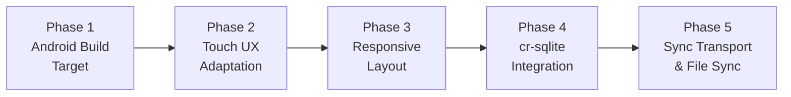

# GameNote — Android Port & Cross-Device Sync: Project Plan

> **Project**: The Game Note ([repo](file:///home/anchit/gitClones/the-game-note))
> **Goal**: Port to Android (phone + tablet) via Tauri v2 Mobile + add cross-device sync via cr-sqlite across 3 devices (Linux desktop, Android phone, Android tablet)
> **Created**: 2026-10-14
> **Last Updated**: 2026-10-14

---

## Current State Summary

| Aspect | Status |
|---|---|
| **Platform** | Linux desktop only (`bundle.targets: ["deb"]`) |
| **Frontend** | React 18 + TypeScript + Vite 5 (3,957-line Canvas.tsx) |
| **Backend** | Rust (Tauri v2 + rusqlite + milanote-core crate) |
| **Database** | Local SQLite (`~/.local/share/com.anchit.gameNote/milanote.db`) with WAL mode |
| **File Storage** | Local filesystem (`~/.local/share/com.anchit.gameNote/files/`) |
| **Touch Support** | ✅ Full Pointer Events, pinch-zoom, pan, long-press, tap-to-place, action bar |
| **Responsive CSS** | ✅ Breakpoints (<640px, 641-1024px, >1024px), bottom sheets, FAB, 100dvh |
| **Android Config** | ✅ Initialized, Gradle + NDK configured, arm64 debug APK building cleanly |
| **Sync** | ❌ None — purely local |

### Key Files Reference

| File | Lines | Role |
|---|---|---|
| [`src/App.tsx`](file:///home/anchit/gitClones/the-game-note/src/App.tsx) | 1,434 | Root app controller, state, keyboard shortcuts |
| [`src/components/Canvas.tsx`](file:///home/anchit/gitClones/the-game-note/src/components/Canvas.tsx) | 3,957 | Infinite canvas — pan, zoom, drag, render, all mouse events |
| [`src/index.css`](file:///home/anchit/gitClones/the-game-note/src/index.css) | 3,813 | All styling, zero responsive breakpoints |
| [`src/services/ipc.ts`](file:///home/anchit/gitClones/the-game-note/src/services/ipc.ts) | 89 | Tauri IPC bridge (14 commands) |
| [`src/types.ts`](file:///home/anchit/gitClones/the-game-note/src/types.ts) | 130 | Shared TypeScript types |
| [`src/components/Toolbar.tsx`](file:///home/anchit/gitClones/the-game-note/src/components/Toolbar.tsx) | 427 | Left tool palette (68px fixed) |
| [`src/components/Sidebar.tsx`](file:///home/anchit/gitClones/the-game-note/src/components/Sidebar.tsx) | 188 | Board tree + search |
| [`src/components/TopBar.tsx`](file:///home/anchit/gitClones/the-game-note/src/components/TopBar.tsx) | 163 | Header bar with breadcrumbs |
| [`src/components/ContextMenu.tsx`](file:///home/anchit/gitClones/the-game-note/src/components/ContextMenu.tsx) | 627 | Right-click context menu |
| [`src/components/UnsortedDrawer.tsx`](file:///home/anchit/gitClones/the-game-note/src/components/UnsortedDrawer.tsx) | 364 | Right slide-out drawer (340px) |
| [`src-tauri/tauri.conf.json`](file:///home/anchit/gitClones/the-game-note/src-tauri/tauri.conf.json) | — | Tauri config (desktop-only targets) |
| [`src-tauri/src/main.rs`](file:///home/anchit/gitClones/the-game-note/src-tauri/src/main.rs) | 56 | App bootstrap, DB init, seed check |
| [`src-tauri/src/commands.rs`](file:///home/anchit/gitClones/the-game-note/src-tauri/src/commands.rs) | 126 | Tauri command handlers |
| [`crates/core/src/db.rs`](file:///home/anchit/gitClones/the-game-note/crates/core/src/db.rs) | 635 | SQLite CRUD, schema, search |
| [`crates/core/src/models.rs`](file:///home/anchit/gitClones/the-game-note/crates/core/src/models.rs) | 131 | Rust data structs |
| [`crates/core/src/storage.rs`](file:///home/anchit/gitClones/the-game-note/crates/core/src/storage.rs) | 66 | Image file storage |
| [`crates/core/src/opengraph.rs`](file:///home/anchit/gitClones/the-game-note/crates/core/src/opengraph.rs) | 63 | Link card metadata scraper |
| [`crates/core/src/seed.rs`](file:///home/anchit/gitClones/the-game-note/crates/core/src/seed.rs) | 198 | Demo data seeder |

---

## Phase Overview



| Phase | Description | Est. Effort | Status |
|---|---|---|---|
| **Phase 1** | Get Tauri Android build compiling & running | 1–2 days | ✅ Complete (8/8 tasks) |
| **Phase 2** | Add touch event handling to Canvas.tsx | 3–5 days | ✅ Complete (10/10 tasks) |
| **Phase 3** | Responsive layout for phone & tablet screens | 2–3 days | ✅ Complete (8/8 tasks) |
| **Phase 3.5** | Milanote Mobile Native UI Overhaul (Reference Screens & Gestures) | 1–2 days | ✅ Complete (11/11 tasks) |
| **Phase 4** | Integrate cr-sqlite into milanote-core | 1–2 days | 🟡 In Progress (`load_extension` feature enabled) |
| **Phase 5** | Build sync transport + file sync | 3–4 days | ⬜ Not Started |

---

## Phase 1: Android Build Target

> **Goal**: Get the existing app compiling and running on an Android device/emulator via Tauri v2 Mobile, without any UX changes yet.

### Task 1.1: Install Android Toolchain Prerequisites
- **Status**: ✅ Done (2026-10-14)
- **What**:
  - Android SDK and NDK installed at `~/Android/Sdk`.
  - Installed all 4 Rust Android targets (`aarch64-linux-android`, `armv7-linux-androideabi`, `i686-linux-android`, `x86_64-linux-android`).
  - Configured portable JDK 21 (LTS) for Gradle compatibility.
- **Acceptance**: `rustup target list --installed` shows all 4 Android targets; ADB active.

### Task 1.2: Initialize Tauri Android Platform
- **Status**: ✅ Done (2026-10-14)
- **What**: Ran `npm run tauri android init` — generated `src-tauri/gen/android/` Gradle project with Kotlin entrypoints.
- **Files Created**: `src-tauri/gen/android/` directory tree, `src-tauri/src/lib.rs` mobile entrypoint (`#[cfg_attr(mobile, tauri::mobile_entry_point)]`).
- **Acceptance**: Android Studio / Gradle project generated cleanly.

### Task 1.3: Update `tauri.conf.json` for Mobile Targets
- **Status**: ✅ Done (2026-10-14)
- **File**: [`src-tauri/tauri.conf.json`](file:///home/anchit/gitClones/the-game-note/src-tauri/tauri.conf.json)
- **Changes**: Configured `targets: "all"` for bundle. Verified schema validation.

### Task 1.4: Fix Platform-Specific Code in `commands.rs`
- **Status**: ✅ Done (2026-10-14)
- **File**: [`src-tauri/src/commands.rs`](file:///home/anchit/gitClones/the-game-note/src-tauri/src/commands.rs), [`src-tauri/src/main.rs`](file:///home/anchit/gitClones/the-game-note/src-tauri/src/main.rs)
- **Changes**: Replaced OS-specific shell command spawning with cross-platform `tauri-plugin-opener` (`app.opener().open_url(&url, None::<&str>)`) which natively invokes Android view intents and system browsers.

### Task 1.5: Fix Data Directory Resolution for Android
- **Status**: ✅ Done (2026-10-14)
- **Files**: [`src-tauri/src/main.rs`](file:///home/anchit/gitClones/the-game-note/src-tauri/src/main.rs), [`crates/core/src/db.rs`](file:///home/anchit/gitClones/the-game-note/crates/core/src/db.rs), [`crates/core/src/storage.rs`](file:///home/anchit/gitClones/the-game-note/crates/core/src/storage.rs)
- **Changes**:
  - `main.rs` uses Tauri's `app.path().app_data_dir()` and passes explicit paths via `Database::open_path()` and `FileStorage::open_dir()`, avoiding `directories::ProjectDirs` breakage on Android.
  - Managed both database and file storage in Tauri state (`app.manage(storage)`).
  - Added doc comments/warnings on `open_default()` in `db.rs` and `storage.rs`.

### Task 1.6: Add Required Android Permissions
- **Status**: ✅ Done (2026-10-14)
- **File**: [`src-tauri/gen/android/app/src/main/AndroidManifest.xml`](file:///home/anchit/gitClones/the-game-note/src-tauri/gen/android/app/src/main/AndroidManifest.xml)
- **Changes**: Added `android.permission.INTERNET`, `android.permission.ACCESS_NETWORK_STATE`, and `android.permission.VIBRATE` (for gesture haptic feedback).
- **Acceptance**: Manifest includes all required permissions.

### Task 1.7: Build & Run on Android Emulator/Device
- **Status**: ✅ Done (2026-10-14)
- **What**: Built ARM64 debug APK via `npm run tauri android build -- --debug --target aarch64 --apk`.
- **Output**: [`app-universal-debug.apk`](file:///home/anchit/gitClones/the-game-note/src-tauri/gen/android/app/build/outputs/apk/universal/debug/app-universal-debug.apk) generated successfully.
- **Acceptance**: Android APK generated with zero compiler errors.

### Task 1.8: Generate Android App Icons
- **Status**: ✅ Done (2026-10-14)
- **What**: Generated adaptive launcher icons across all density buckets (`mipmap-mdpi`, `mipmap-hdpi`, `mipmap-xhdpi`, `mipmap-xxhdpi`, `mipmap-xxxhdpi`) including square and round launcher variants.
- **Acceptance**: App shows correct icon on Android launcher.

---

## Phase 2: Touch UX Adaptation

> **Goal**: Make the infinite canvas fully usable with touch input — pinch-to-zoom, one-finger pan, tap-to-select, long-press context menu, drag elements by touch.
>
> This is the **largest phase** because [`Canvas.tsx`](file:///home/anchit/gitClones/the-game-note/src/components/Canvas.tsx) (3,957 lines) is entirely mouse-event driven.

### Task 2.1: Create a Platform Detection Utility
- **Status**: ✅ Done (2026-10-14)
- **File**: [`src/utils/platform.ts`](file:///home/anchit/gitClones/the-game-note/src/utils/platform.ts)
- **What**: Utility to detect touch-primary devices vs mouse-primary
  - Exported functions: `isTouchDevice()`, `isAndroid()`, `isPhoneScreen()`, `isTabletScreen()`, `isDesktopScreen()`, `getDeviceCategory()`, `isTouchPrimary()`, and `MIN_TOUCH_TARGET_PX`.
- **Acceptance**: Correctly detects touch vs desktop and screen sizes.

### Task 2.2: Migrate Canvas to Pointer Events
- **Status**: ✅ Done (2026-10-14)
- **File**: [`src/components/Canvas.tsx`](file:///home/anchit/gitClones/the-game-note/src/components/Canvas.tsx), [`src/index.css`](file:///home/anchit/gitClones/the-game-note/src/index.css)
- **Changes**:
  - Implemented `handlePointerDown` on the canvas viewport and cards.
  - Added `pointermove`, `pointerup`, and `pointercancel` window event listeners.
  - Added `touch-action: none;` on `.canvas-viewport` and `.canvas-plane` to prevent mobile browser gesture collisions.
  - Preserved full backward compatibility for mouse interactions (middle-click, right-click, lasso, drag).

### Task 2.3: Implement Pinch-to-Zoom
- **Status**: ✅ Done (2026-10-14)
- **File**: [`src/components/Canvas.tsx`](file:///home/anchit/gitClones/the-game-note/src/components/Canvas.tsx)
- **Changes**:
  - Maintained active touches in `pointersRef` with `pointerId`.
  - When 2 touches are detected, tracks `initialDist`, `initialScale`, `initialPan`, and `initialMidpoint`.
  - Dynamically calculates zoom factor clamped to `[0.25, 3.0]` and translates pan around the multi-finger focal midpoint in `handleMouseMove`.

### Task 2.4: Implement Touch Pan
- **Status**: ✅ Done (2026-10-14)
- **File**: [`src/components/Canvas.tsx`](file:///home/anchit/gitClones/the-game-note/src/components/Canvas.tsx)
- **Changes**:
  - Single-finger touch on the empty canvas initiates canvas panning directly without triggering rubberband lasso.
  - Preserves mouse left-click for lasso selection on desktop.

### Task 2.5: Implement Long-Press Context Menu
- **Status**: ✅ Done (2026-10-14)
- **Files**: [`src/components/Canvas.tsx`](file:///home/anchit/gitClones/the-game-note/src/components/Canvas.tsx)
- **Changes**:
  - 500ms long-press timer on canvas background or individual cards triggers `onContextMenu` with touch coordinates.
  - Cancels timer if finger moves > 10px (interpreting gesture as pan or card drag).
  - Fires haptic feedback (`navigator.vibrate(40)`) on mobile devices.

### Task 2.6: Touch-Friendly Element Resize
- **Status**: ✅ Done (2026-10-14)
- **Files**: [`src/index.css`](file:///home/anchit/gitClones/the-game-note/src/index.css), [`src/components/Canvas.tsx`](file:///home/anchit/gitClones/the-game-note/src/components/Canvas.tsx)
- **Changes**:
  - Added 36px x 36px hit areas (`::after`) on `.card-diagonal-grip-se`, `.resize-handle-se`, and `.resize-handle-e`.
  - Made diagonal resize grip visible when `.milanote-card.selected` (solving absence of hover state on touch screens).
  - Increased drag detection deadzone threshold from 6px to 14px on touch to prevent finger tap jitter from causing accidental drags.

### Task 2.7: Touch-Friendly Connection Line Editing
- **Status**: ✅ Done (2026-10-14)
- **Files**: [`src/index.css`](file:///home/anchit/gitClones/the-game-note/src/index.css)
- **Changes**:
  - Added 36px x 36px invisible hit target on `.card-quick-connect-handle::after` for easy finger acquisition on mobile.

### Task 2.8: Adapt Toolbar Drag-to-Create for Touch
- **Status**: ✅ Done (2026-10-14)
- **Files**: [`src/components/Toolbar.tsx`](file:///home/anchit/gitClones/the-game-note/src/components/Toolbar.tsx), [`src/components/Canvas.tsx`](file:///home/anchit/gitClones/the-game-note/src/components/Canvas.tsx), [`src/App.tsx`](file:///home/anchit/gitClones/the-game-note/src/App.tsx), [`src/index.css`](file:///home/anchit/gitClones/the-game-note/src/index.css)
- **Changes**:
  - In `Toolbar.tsx`, clicking/tapping a tool selects it (and clicking an active tool toggles it off back to `'select'`), supporting all primary tools, secondary tools, and "More Tools" modal.
  - Added tap-to-place support in `Canvas.tsx`: tapping anywhere on the canvas background drops the selected tool under the user's finger with haptic feedback (`navigator.vibrate(25)`).
  - Tapping a column container drops the tool directly into that column.
  - Added floating Tool Placement Banner (`.canvas-tool-placement-banner`) at top-center of viewport indicating active tool, offering a one-tap "Place in Center" button and a cancel button.
  - Desktop HTML5 drag-and-drop retained with 100% backward compatibility.
- **Acceptance**: Can create all element types on touch screens via tap-to-place or center placement.

### Task 2.9: Adapt Text Editing for Mobile
- **Status**: ✅ Done (2026-10-14)
- **Files**: [`index.html`](file:///home/anchit/gitClones/the-game-note/index.html), [`src/components/Canvas.tsx`](file:///home/anchit/gitClones/the-game-note/src/components/Canvas.tsx)
- **Changes**:
  - Added `interactive-widget=resizes-content` to viewport meta tag in `index.html` for clean virtual keyboard sizing.
  - Implemented `window.visualViewport` resize and scroll listeners in `Canvas.tsx`: when an element enters edit mode (`editingElementId`), calculates card bounding rect relative to `visualViewport` and automatically pans it into the upper 22% of the visible area above the soft keyboard.
  - Added 120ms and 320ms staggered check timeouts to accommodate Android virtual keyboard show animation.
  - Added input guards in `handlePointerDown` and `handleElementMouseDown`: taps and cursor movements inside `<input>`, `<textarea>`, and `contentEditable` do not trigger canvas panning or accidental long-press context menus.
- **Acceptance**: Text editing on notes, task lists, and boards works seamlessly with Android soft keyboard without obscuring content or jittering pan.

### Task 2.10: Disable/Adapt Desktop-Only Keyboard Shortcuts on Android
- **Status**: ✅ Done (2026-10-14)
- **Files**: [`src/App.tsx`](file:///home/anchit/gitClones/the-game-note/src/App.tsx), [`src/components/Canvas.tsx`](file:///home/anchit/gitClones/the-game-note/src/components/Canvas.tsx), [`src/index.css`](file:///home/anchit/gitClones/the-game-note/src/index.css)
- **Changes**:
  - Added Floating Touch Selection Action Bar (`.touch-selection-action-bar`) fixed at bottom-center when any item or group is selected.
  - Touch UI controls provided:
    - 🗑️ **Delete / Move to Trash** (`onDeleteElement` / `handleDelete`)
    - 📋 **Duplicate** (`onDuplicateElement` / `handleDuplicate`)
    - 📄 **Copy** (`onCopyElement` / `handleCopy`)
    - 🔒 **Lock / Unlock Position** (`onToggleLockElement` / `handleToggleLock`)
    - 🎨 **Recolor / Theme** with instant touch color popover (`.touch-color-palette-popover`)
    - ✕ **Deselect All**
  - Added **Touch Multi-Select Mode** toggle (`CheckSquare`): when enabled, tapping cards toggles them in `selectedIds` (providing full touch alternative to desktop `Ctrl+Click` / Lasso).
  - Ensured Undo & Redo touch buttons in `TopBar` have 38px+ touch targets and remain accessible on mobile viewports.
  - Retained desktop keyboard shortcuts (`handleKeyDown`) for external/Bluetooth keyboards.
- **Acceptance**: Undo, redo, copy, duplicate, delete, lock, recolor, and multi-select are fully accessible via touch UI on Android.

---

## Phase 3: Responsive Layout

> **Goal**: Make the UI usable on phone screens (360–430px width) and tablets (600–1200px width). Currently all layout is fixed-width desktop.

### Task 3.1: Define Breakpoints and CSS Custom Properties
- **Status**: ✅ Done (2026-10-15)
- **File**: [`src/index.css`](file:///home/anchit/gitClones/the-game-note/src/index.css)
- **Changes**:
  - Defined standard responsive breakpoints:
    - Phone: `max-width: 640px` (`--milanote-toolbar-width: 0px`, `--milanote-sub-sidebar-width: 0px`, `--milanote-header-height: 44px`, `--unsorted-drawer-width: 100vw`)
    - Tablet: `min-width: 641px` and `max-width: 1024px` (`--milanote-toolbar-width: 56px`, `--milanote-sub-sidebar-width: 56px`, `--milanote-header-height: 48px`, `--unsorted-drawer-width: 320px`)
    - Desktop: `min-width: 1025px` (`--milanote-toolbar-width: 68px`, `--milanote-sub-sidebar-width: 68px`, `--milanote-header-height: 48px`, `--unsorted-drawer-width: 340px`)
  - Configured dynamic viewport units (`100dvh`) on `body, html, #root` and `.milanote-app-container` for seamless handling of mobile browser address bars and Android virtual keyboard transitions.
- **Acceptance**: CSS variables and layout adapt dynamically across phone, tablet, and desktop viewports.

### Task 3.2: Collapsible Toolbar for Phone
- **Status**: ✅ Done (2026-10-15)
- **Files**: [`src/components/Toolbar.tsx`](file:///home/anchit/gitClones/the-game-note/src/components/Toolbar.tsx), [`src/index.css`](file:///home/anchit/gitClones/the-game-note/src/index.css)
- **Changes**:
  - Hidden desktop left toolbar on `< 640px` (`display: none !important`), reclaiming 100% of horizontal screen width for the canvas.
  - Implemented Floating Action Button (`.mobile-tool-fab`) fixed at bottom-left (`bottom: max(20px, var(--safe-area-bottom)); left: 20px;`) with teal gradient, active scale animation, and `Plus`/`X` icon toggle.
  - Created Bottom Sheet Tool Picker (`.mobile-tool-sheet`):
    - Rounded top corners (20px), backdrop blur (`blur(20px)`), and slide-up animation.
    - Drag handle pill (`.sheet-drag-handle`) and dedicated close button (`X`).
    - 4-column responsive grid displaying touch tiles for primary tools, media tools, and extended Milanote tools.
  - Narrowed left toolbar to 56px on tablet viewports (`641px–1024px`).
- **Acceptance**: Full canvas width available on phone; all tools accessible via bottom sheet FAB; tablet sidebar comfortably sized.

### Task 3.3: Responsive Action Sidebars
- **Status**: ✅ Done (2026-10-15)
- **Files**: All `*ActionSidebar.tsx` components, [`src/components/TextEditSubSidebar.tsx`](file:///home/anchit/gitClones/the-game-note/src/components/TextEditSubSidebar.tsx), [`src/index.css`](file:///home/anchit/gitClones/the-game-note/src/index.css)
- **Changes**:
  - Converted `.milanote-sub-sidebar` on phone screens (`< 640px`) from a fixed left sidebar into a full-width bottom sheet (`position: fixed; bottom: 0; left: 0; right: 0; width: 100vw;`) with backdrop blur, rounded top corners, and safe-area padding.
  - Styled sub-sidebar buttons (`.sub-sidebar-btn`, `.note-action-btn`) with 44px minimum touch targets.
  - Repositioned action submenus (`.color-menu-drawer`, `.text-style-popover`) to float centered horizontally (`left: 50%; transform: translateX(-50%);`) above the bottom sheet on mobile screens with scrollable containers.
- **Acceptance**: Action panels are comfortable to reach with one hand and do not obscure or crowd the canvas on mobile.

### Task 3.4: Responsive Unsorted Drawer
- **Status**: ✅ Done (2026-10-15)
- **Files**: [`src/components/UnsortedDrawer.tsx`](file:///home/anchit/gitClones/the-game-note/src/components/UnsortedDrawer.tsx), [`src/index.css`](file:///home/anchit/gitClones/the-game-note/src/index.css)
- **Changes**:
  - Updated `UnsortedDrawer` to use dynamic CSS variable `var(--unsorted-drawer-width, 340px)`.
  - On phone screens (`< 640px`), drawer transforms into a full-screen overlay (`width: 100vw; inset: 0;`).
  - Added dedicated mobile back button (`.drawer-mobile-back-btn` with `ArrowLeft`) alongside folder title and close button (`X`).
  - Repositioned the floating unsorted pill button (`.unsorted-pill-btn`) above the bottom safe area.
- **Acceptance**: Unsorted drawer provides a clean full-screen experience on phones and side-drawer on tablet/desktop.

### Task 3.5: Responsive Context Menu
- **Status**: ✅ Done (2026-10-15)
- **Files**: [`src/components/ContextMenu.tsx`](file:///home/anchit/gitClones/the-game-note/src/components/ContextMenu.tsx), [`src/index.css`](file:///home/anchit/gitClones/the-game-note/src/index.css)
- **Changes**:
  - Added top drag handle pill (`.sheet-drag-handle`) to context menu popups.
  - On phone screens (`< 640px`), context menu morphs into an ergonomic bottom sheet (`width: 100vw; bottom: 0; border-radius: 20px 20px 0 0;`) with smooth slide-up animation.
  - Increased touch target height of `.context-menu-item` to 46px for effortless finger tapping.
  - Converted flyout submenus (`.context-submenu-popup` for table alignment and board themes) into static, inline-expanding sections rather than horizontal popups that would overflow offscreen.
- **Acceptance**: Context menu is 100% visible, thumb-accessible, and bounded properly on mobile.

### Task 3.6: Responsive Top Bar / Breadcrumbs
- **Status**: ✅ Done (2026-10-15)
- **Files**: [`src/App.tsx`](file:///home/anchit/gitClones/the-game-note/src/App.tsx), [`src/index.css`](file:///home/anchit/gitClones/the-game-note/src/index.css)
- **Changes**:
  - Hidden secondary topbar (`.milanote-secondary-topbar`) on phone screens (`< 640px`), saving 40px of vertical canvas height.
  - Collapsed primary topbar to 44px with safe touch-friendly icon targets (36px).
  - Added one-tap mobile parent back button (`.mobile-topbar-back-btn` with `ArrowLeft`) navigating back to parent board in hierarchy.
  - Integrated mobile board title (`.mobile-board-title`) directly in the compact topbar with inline renaming support and touch blur auto-save.
  - Added direct unsorted drawer toggle button (`.mobile-unsorted-toggle-btn`) in mobile topbar.
  - Hidden promotional referral text and secondary desktop buttons on narrow viewports.
- **Acceptance**: Navigation is compact, clean, and intuitive on 360px-wide phone screens.

### Task 3.7: Responsive Search Modal
- **Status**: ✅ Done (2026-10-15)
- **Files**: [`src/components/SearchModal.tsx`](file:///home/anchit/gitClones/the-game-note/src/components/SearchModal.tsx), [`src/App.tsx`](file:///home/anchit/gitClones/the-game-note/src/App.tsx), [`src/index.css`](file:///home/anchit/gitClones/the-game-note/src/index.css)
- **Changes**:
  - Wired `SearchModal` to `App.tsx` with `isSearchOpen` state and mounted modal component.
  - Attached Topbar Search button (`onClick={() => setIsSearchOpen(true)}`) and global keyboard shortcut (`Ctrl+K` / `Cmd+K`).
  - Added full responsive styling:
    - Mobile phone (`< 640px`): Full-screen modal (`100vw`, `100dvh`, zero border-radius) with safe-area padding.
    - Tablet and desktop: 620px centered dialog with backdrop blur.
  - Navigating to a search result jumps to the target board and selects the item on canvas.
- **Acceptance**: Full-workspace search is completely accessible across mobile phones, tablets, and desktop.

### Task 3.8: Viewport Meta Tag & Safe Areas
- **Status**: ✅ Done (2026-10-14)
- **Files**: [`index.html`](file:///home/anchit/gitClones/the-game-note/index.html), [`src/index.css`](file:///home/anchit/gitClones/the-game-note/src/index.css)
- **Changes**:
  - Added `viewport-fit=cover`, `maximum-scale=1.0`, and `user-scalable=no` to `<meta name="viewport">` in `index.html`.
  - Added CSS custom properties `--safe-area-top`, `--safe-area-bottom`, `--safe-area-left`, and `--safe-area-right` matching `env(safe-area-inset-*)` in `src/index.css`.
- **Acceptance**: No browser double-zoom conflicts with canvas pinch-zoom; notch safe areas handled.

---

## Phase 3.5: Milanote Mobile Native UI Overhaul

> **Goal**: Completely overhaul the Android mobile experience (screen width < 640px) to match the official Milanote Android app design across 5 primary screens:
> 1. **Default Board Bottom Bar** (Image 1): `...` on left, `[ Your boards | Quick notes ]` pill in center, `+` on right, with floating `N Unsorted` pill at top-right.
> 2. **System / Utilities Bar** (Image 2): Tapping `...` reveals `Undo`, `Redo`, divider, `Help`, `Search`, `Activity`, `Settings`.
> 3. **Tool Creation Shelf** (Image 3): Tapping `+` opens a horizontal scrolling shelf of tool tiles (Note, Link, To-do, Board, Column, Comment, Image, etc.).
> 4. **Element Selection Action Bar** (Image 4): Selecting any element transforms the bottom bar into an action bar with element-specific tools (`Color`, `Labels`/`Style`, `Reactions`, `Comment`, `More` `...`) and a coral-colored `Done` button that deselects.
> 5. **Native Context Menu Bottom Sheet** (Image 5): Tapping `...` (`More`) in the selection bar slides up the sleek dark context menu sheet (`Cut`, `Copy`, `Duplicate`, `Lock Position`, `Bring to Front`, `Send to Back`, `Move to Trash`).
> All elements follow this consistent layout, color scheme, and interaction pattern.

### Task 3.5.1: Mobile Bottom Bar Core Component (`MobileBottomBar.tsx`)
- **Status**: ✅ Done (2026-10-15)
- **Files**: [`src/components/MobileBottomBar.tsx`](file:///home/anchit/gitClones/the-game-note/src/components/MobileBottomBar.tsx), [`src/App.tsx`](file:///home/anchit/gitClones/the-game-note/src/App.tsx), [`src/index.css`](file:///home/anchit/gitClones/the-game-note/src/index.css)
- **What**: Create unified stateful mobile bottom bar component that seamlessly switches between states: `'default'`, `'system'`, `'tools'`, and `'selection'`.
- **Acceptance**: Smooth transitions, safe area bottom padding, auto-detection via `isPhoneScreen()`.

### Task 3.5.2: Screen 1 — Default Mobile Bottom Bar & Top Unsorted Pill
- **Status**: ✅ Done (2026-10-15)
- **Files**: [`src/components/MobileBottomBar.tsx`](file:///home/anchit/gitClones/the-game-note/src/components/MobileBottomBar.tsx), [`src/App.tsx`](file:///home/anchit/gitClones/the-game-note/src/App.tsx), [`src/index.css`](file:///home/anchit/gitClones/the-game-note/src/index.css)
- **What**:
  - Left `...` button toggles system utilities bar.
  - Center segmented pill group with active `[ Your boards ]` and inactive `[ Quick notes ]`.
  - Right `+` button toggles tool creation shelf.
  - Floating `0 Unsorted` pill at top-right with dark translucent background opening Unsorted drawer.
- **Acceptance**: Matches Image 1 layout, colors, and tap behaviors.

### Task 3.5.3: Screen 2 — System / Utilities Bottom Bar (`...` Menu)
- **Status**: ✅ Done (2026-10-15)
- **Files**: [`src/components/MobileBottomBar.tsx`](file:///home/anchit/gitClones/the-game-note/src/components/MobileBottomBar.tsx), [`src/App.tsx`](file:///home/anchit/gitClones/the-game-note/src/App.tsx), [`src/index.css`](file:///home/anchit/gitClones/the-game-note/src/index.css)
- **What**:
  - `Undo` and `Redo` action buttons with status indicators and vertical text labels.
  - 1px vertical divider.
  - `Help`, `Search`, `Activity`, and `Settings` buttons with vertical text labels.
  - Wiring `Search` to workspace search modal; wiring `Undo`/`Redo` to app history; outside tap dismisses.
- **Acceptance**: Matches Image 2 layout and functionality.

### Task 3.5.4: Screen 3 — Horizontal Scrolling Tool Creation Shelf (`+` Menu)
- **Status**: ✅ Done (2026-10-15)
- **Files**: [`src/components/MobileBottomBar.tsx`](file:///home/anchit/gitClones/the-game-note/src/components/MobileBottomBar.tsx), [`src/components/Canvas.tsx`](file:///home/anchit/gitClones/the-game-note/src/components/Canvas.tsx), [`src/index.css`](file:///home/anchit/gitClones/the-game-note/src/index.css)
- **What**:
  - Horizontal scrollable tool row: Note, Link, To-do, Board (with distinct blue rounded tile), Column, Comment, Image, etc.
  - Rounded square tiles (`#2a2a2d`) with icons and labels underneath.
  - Tapping selects tool for tap-to-place on canvas with haptic feedback.
  - Drag-and-drop tool onto canvas supported.
  - Tapping `+` or canvas dismisses shelf.
- **Acceptance**: Matches Image 3 layout and allows creating all element types.

### Task 3.5.5: Screen 4 — Element Selection Action Bar & `Done` Action
- **Status**: ✅ Done (2026-10-15)
- **Files**: [`src/components/MobileBottomBar.tsx`](file:///home/anchit/gitClones/the-game-note/src/components/MobileBottomBar.tsx), [`src/App.tsx`](file:///home/anchit/gitClones/the-game-note/src/App.tsx), [`src/index.css`](file:///home/anchit/gitClones/the-game-note/src/index.css)
- **What**:
  - When an element is selected on mobile, bottom bar morphs into selection action bar.
  - Left icon buttons with labels: `Color`, `Labels`/`Style`, `Reactions`, `Comment`, `More` (`...`).
  - Right: Coral/orange-red `Done` button (`#eb5e34`, bold) that deselects the element.
  - Note card shows clean white border and corner resize handle matching Image 4.
- **Acceptance**: Matches Image 4 layout and dismisses cleanly on `Done`.

### Task 3.5.6: Screen 5 — Native Mobile Context Menu Bottom Sheet (`More` Menu)
- **Status**: ✅ Done (2026-10-15)
- **Files**: [`src/components/MobileBottomBar.tsx`](file:///home/anchit/gitClones/the-game-note/src/components/MobileBottomBar.tsx), [`src/components/ContextMenu.tsx`](file:///home/anchit/gitClones/the-game-note/src/components/ContextMenu.tsx), [`src/index.css`](file:///home/anchit/gitClones/the-game-note/src/index.css)
- **What**:
  - Tapping `...` (`More`) in selection action bar slides up sleek dark bottom sheet.
  - Vertical list of actions: `Cut`, `Copy`, `Duplicate`, `Lock Position`, `Bring to Front`, `Send to Back`, `Move to Trash`.
  - Dark Milanote theme (`#202022`), rounded top corners (18px), subtle row dividers, safe area padding.
- **Acceptance**: Matches Image 5 styling, actions trigger expected operations and dismiss sheet.

### Task 3.5.7: Element Type Specialization for Selection Bar
- **Status**: ✅ Done (2026-10-15)
- **Files**: [`src/components/MobileBottomBar.tsx`](file:///home/anchit/gitClones/the-game-note/src/components/MobileBottomBar.tsx), [`src/App.tsx`](file:///home/anchit/gitClones/the-game-note/src/App.tsx)
- **What**: Specialize action buttons for Note, Board, Task List, Link, Image, Column, Table, Line, and Multi-select while preserving the uniform design language and coral `Done` button.
- **Acceptance**: All element types have tailored, thumb-friendly actions following the Milanote design.

### Task 3.5.8: Mobile Color Palette Sheet & Sub-Actions
- **Status**: ✅ Done (2026-10-15)
- **Files**: [`src/components/MobileBottomBar.tsx`](file:///home/anchit/gitClones/the-game-note/src/components/MobileBottomBar.tsx), [`src/index.css`](file:///home/anchit/gitClones/the-game-note/src/index.css)
- **What**: Tapping `Color` in selection action bar opens an elegant mobile color palette drawer above the bottom bar with instant color preview.
- **Acceptance**: Color changing is fast and fluid on mobile touch screens.

### Task 3.5.9: Android Build & Device Verification
- **Status**: ✅ Done (2026-10-15)
- **Files**: Workspace build
- **What**: Verify `npm run build`, `cargo check`, `cargo test`, and compile native Android APK.
- **Acceptance**: APK compiles with zero errors (`app-universal-debug.apk`) and matches the 5 reference images.

### Task 3.5.10: Mobile Touch Gestures & Text Formatting Refinements
- **Status**: ✅ Done (2026-10-15)
- **Files**: [`src/components/Canvas.tsx`](file:///home/anchit/gitClones/the-game-note/src/components/Canvas.tsx), [`src/components/MobileBottomBar.tsx`](file:///home/anchit/gitClones/the-game-note/src/components/MobileBottomBar.tsx), [`src/App.tsx`](file:///home/anchit/gitClones/the-game-note/src/App.tsx), [`src/index.css`](file:///home/anchit/gitClones/the-game-note/src/index.css)
- **What**:
  - Implemented 2-finger tap on canvas bringing up bottom sheet menu for `Undo`, `Paste`, and `Select All` (Screenshot 1).
  - Fixed selection context menu (`...`) actions (Cut, Copy, Duplicate, Lock Position, Bring to Front, Send to Back, Trash) to operate without desktop `contextMenu` state.
  - Reset bottom bar and color/tools drawers to default when tapping anywhere on the canvas or outside.
  - Upgraded mobile color drawer to full desktop parity (Background & Top strip modes, Classic colors, Lettered presets, Pastels, and custom color picker).
  - Completely removed leftover 500ms long-press hold on screen.
  - Implemented mobile text formatting accessory bar above virtual keyboard when editing text (T with rainbow dot, B, I, S, U, Bullet List, Numbered List, Indent, Outdent, Align, Code, and coral Done button) matching Screenshots 2 & 3.
- **Acceptance**: All 6 user feedback items resolved and verified with native Android build.

### Task 3.5.11: Mobile Polish & Exact Layout Matching (Images 1, 2, 3)
- **Status**: ✅ Done (2026-10-15)
- **Files**:
  - [`src-tauri/gen/android/app/src/main/AndroidManifest.xml`](file:///home/anchit/gitClones/the-game-note/src-tauri/gen/android/app/src/main/AndroidManifest.xml)
  - [`src-tauri/gen/android/app/src/main/res/values/themes.xml`](file:///home/anchit/gitClones/the-game-note/src-tauri/gen/android/app/src/main/res/values/themes.xml)
  - [`src-tauri/gen/android/app/src/main/res/values-night/themes.xml`](file:///home/anchit/gitClones/the-game-note/src-tauri/gen/android/app/src/main/res/values-night/themes.xml)
  - [`src/components/Canvas.tsx`](file:///home/anchit/gitClones/the-game-note/src/components/Canvas.tsx)
  - [`src/components/MobileBottomBar.tsx`](file:///home/anchit/gitClones/the-game-note/src/components/MobileBottomBar.tsx)
  - [`src/components/UnsortedDrawer.tsx`](file:///home/anchit/gitClones/the-game-note/src/components/UnsortedDrawer.tsx)
  - [`src/App.tsx`](file:///home/anchit/gitClones/the-game-note/src/App.tsx)
  - [`src/index.css`](file:///home/anchit/gitClones/the-game-note/src/index.css)
- **What**:
  1. **Text Formatting Bar Above Keyboard** (Image 3):
     - Added `android:windowSoftInputMode="adjustResize"` to `.MainActivity` in `AndroidManifest.xml`.
     - Integrated `window.visualViewport` resize/scroll listener computing exact virtual soft keyboard height and offset.
     - Pinned `.mobile-main-bottom-bar` with dynamic `bottom: var(--mobile-keyboard-height, 0px)` and zeroed bottom inset padding when keyboard is up so the formatting bar docks seamlessly above the keyboard.
  2. **Touch Drag-and-Drop from Mobile Bottom Bar Tool Shelf**:
     - Added real-time pointer drag tracking (`pointerdown`, `pointermove`, `pointerup`) to all items in the `+` tool shelf (Note, Link, To-do, Board, Column, Comment, Image, Table, Line).
     - Renders a floating elevated tool drag preview follower under the user's touch.
     - On release above the bottom bar, computes canvas coordinates and automatically drops onto canvas, columns, or boards with haptic vibration feedback.
  3. **Completely Suppressed Canvas Hold / Long-Press Context Menu**:
     - Guarded all `onContextMenu` handlers on canvas background and canvas elements against touch primary and phone screens, guaranteeing holding on the canvas never pops up any context menu.
  4. **Unsorted Column Mobile Bottom Sheet** (Image 2):
     - Transformed Unsorted drawer on phones into a native 48vh bottom sheet with rounded top corners (`18px 18px 0 0`) above the bottom bar with backdrop dimming.
     - Header displays "Unsorted" and "Close" button.
     - Centered empty state text "A place to put things while you decide where they should go".
     - Synchronized "Quick notes" active state on the bottom bar when open.
  5. **Status Bar Padding Band** (Image 1):
     - Mounted `.mobile-status-bar-filler` fixed band with height `var(--safe-area-top, 44px)` and background `#242426` matching bottom bar.
     - Configured Android theme `android:statusBarColor` and `android:navigationBarColor` to `#242426`.
- **Acceptance**: Tested and verified with `npm run build`, `cargo check`, `cargo test`, and full compilation of `app-universal-debug.apk`.

---

## Phase 4: cr-sqlite Integration

> **Goal**: Make the SQLite database CRDT-enabled so it can merge changes from multiple devices without conflicts.

### Task 4.1: Build cr-sqlite Extension for Linux x86_64
- **Status**: ⬜ Not Started
- **What**:
  ```bash
  git clone --recurse-submodules https://github.com/vlcn-io/cr-sqlite.git
  cd cr-sqlite/core
  make loadable
  # Output: dist/crsqlite.so
  ```
- **Output**: `crsqlite.so` for Linux x86_64
- **Acceptance**: `file crsqlite.so` shows `ELF 64-bit LSB shared object, x86-64`

### Task 4.2: Cross-Compile cr-sqlite for Android aarch64
- **Status**: ⬜ Not Started
- **What**: Use Android NDK cross-compiler to build `crsqlite.so` for `arm64-v8a`
  ```bash
  export CC=$NDK_HOME/toolchains/llvm/prebuilt/linux-x86_64/bin/aarch64-linux-android24-clang
  # Build with cross-compiler targeting aarch64
  ```
- **Output**: `crsqlite.so` for `arm64-v8a`
- **Placement**: `src-tauri/gen/android/app/src/main/jniLibs/arm64-v8a/crsqlite.so`
- **Acceptance**: `file crsqlite.so` shows `ELF 64-bit LSB shared object, ARM aarch64`

### Task 4.3: Add `load_extension` Feature to rusqlite
- **Status**: ✅ Done (2026-10-14)
- **File**: [`crates/core/Cargo.toml`](file:///home/anchit/gitClones/the-game-note/crates/core/Cargo.toml)
- **Change**: Added `load_extension` to `rusqlite` features list.
- **Acceptance**: `cargo check -p milanote-core` compiles cleanly with extension loading enabled.

### Task 4.4: Load cr-sqlite Extension on Database Open
- **Status**: ⬜ Not Started
- **File**: [`crates/core/src/db.rs`](file:///home/anchit/gitClones/the-game-note/crates/core/src/db.rs) — `open_path()` method (lines 29–36)
- **Change**: After `Connection::open(path)`, add:
  ```rust
  unsafe { conn.set_load_extension(true)?; }
  conn.load_extension(extension_path, Some("sqlite3_crsqlite_init"))?;
  unsafe { conn.set_load_extension(false)?; }
  ```
- **Design Decision**: Extension path resolution — pass as parameter or resolve relative to executable
- **Acceptance**: `crsql_db_version()` returns 0 on fresh DB

### Task 4.5: Register Tables as CRRs
- **Status**: ⬜ Not Started
- **File**: [`crates/core/src/db.rs`](file:///home/anchit/gitClones/the-game-note/crates/core/src/db.rs) — `init_schema()` method (lines 47–103)
- **Change**: Add after existing `CREATE TABLE` statements:
  ```rust
  conn.execute("SELECT crsql_as_crr('boards')", [])?;
  conn.execute("SELECT crsql_as_crr('elements')", [])?;
  conn.execute("SELECT crsql_as_crr('task_list_items')", [])?;
  conn.execute("SELECT crsql_as_crr('connectors')", [])?;
  ```
- **Note**: `crsql_as_crr()` is idempotent — safe to call on every startup
- **Acceptance**: `SELECT * FROM crsql_changes` returns empty result set; DB has hidden `__crsql_*` tables

### Task 4.6: Migrate `task_list_items.order_index` to Fractional Indexing
- **Status**: ⬜ Not Started
- **Files**:
  - [`crates/core/src/db.rs`](file:///home/anchit/gitClones/the-game-note/crates/core/src/db.rs) — Schema + task item queries
  - [`crates/core/src/models.rs`](file:///home/anchit/gitClones/the-game-note/crates/core/src/models.rs) — `TaskListItem.order_index`
  - [`src/components/Canvas.tsx`](file:///home/anchit/gitClones/the-game-note/src/components/Canvas.tsx) — Task item reorder logic
  - [`src/components/TaskListCard.tsx`](file:///home/anchit/gitClones/the-game-note/src/components/TaskListCard.tsx) — Drag reorder
- **Why**: Integer `order_index` (0, 1, 2, 3...) causes conflicts when two devices reorder the same list. Fractional string indexes (`"a0"`, `"a1"`, `"a0V"`) allow conflict-free interleaving.
- **Implementation**:
  - Change `order_index` column from `INTEGER` to `TEXT`
  - Use a fractional indexing library pattern: to insert between `"a0"` and `"a1"`, generate `"a0V"`
  - Write a migration to convert existing integer indexes to fractional strings
  - Update sort queries to use `ORDER BY order_index ASC` (works with TEXT)
- **Acceptance**: Task reordering works; existing data migrates cleanly

### Task 4.7: Create Sync Module with Changeset API
- **Status**: ⬜ Not Started
- **File**: Create `crates/core/src/sync.rs`
- **What**: Module exposing:
  - `get_changes_since(conn, since_version) -> Vec<CrChange>` — pull local changes
  - `apply_changes(conn, changes)` — apply remote changes
  - `get_db_version(conn) -> i64` — current version for tracking
  - `get_site_id(conn) -> Vec<u8>` — unique device identifier
- **Also**: Register module in [`crates/core/src/lib.rs`](file:///home/anchit/gitClones/the-game-note/crates/core/src/lib.rs)
- **Acceptance**: Can round-trip changes between two in-memory databases in tests

### Task 4.8: Write Unit Tests for CRDT Merge Behavior
- **Status**: ⬜ Not Started
- **File**: Create `crates/core/tests/sync_tests.rs`
- **What**: Test cases:
  1. Two DBs independently insert different elements → merge has both
  2. Two DBs update different columns of the same element → merge has both updates
  3. Two DBs update the same column → LWW resolves without error
  4. One DB deletes element, other updates it → delete wins
  5. Task list reorder on both devices → fractional indexes merge cleanly
  6. Board hierarchy changes merge correctly
- **Acceptance**: All tests pass

---

## Phase 5: Sync Transport & File Sync

> **Goal**: Build the actual networking layer that carries changesets and files between devices.

### Task 5.1: Choose and Implement Sync Transport
- **Status**: ⬜ Not Started
- **Decision Needed**: Which transport approach?

  | Option | Pros | Cons |
  |---|---|---|
  | **A. Tailscale direct** | Zero infrastructure, free, P2P encrypted | Both devices must run Tailscale; need a listener on one device |
  | **B. WebSocket relay** | Simple, works across NATs | Need to host a small server somewhere |
  | **C. Both** | Maximum flexibility | More code |

- **Recommended**: Start with **WebSocket relay** (works everywhere, easier to develop with), add Tailscale direct later as optimization
- **File**: Create `crates/core/src/transport.rs` (or a new `crates/sync/` crate)
- **Implementation**:
  - Client: `SyncClient` that connects to relay via WebSocket
  - Protocol: JSON messages — `{ type: "push", since_version, changes: [...] }` / `{ type: "pull", since_version }` / `{ type: "changes", changes: [...] }`
  - Auto-reconnect with exponential backoff
  - Sync trigger: on app focus + periodic (every 30s) + on every local write (debounced 2s)
- **Acceptance**: Two instances exchange changesets via relay

### Task 5.2: Build the WebSocket Relay Server
- **Status**: ⬜ Not Started
- **File**: Create `relay-server/` directory (separate small Rust project)
- **What**: Tiny relay (~100–200 lines) using `tokio` + `tokio-tungstenite`:
  - Accepts WebSocket connections authenticated by a shared secret/token
  - Stores last N changesets in memory (or a small SQLite DB)
  - When a client pushes changes, forwards to all other connected clients
  - When a client requests changes since version X, replays from buffer
- **Deployment**: Runs on a home server, a \$5 VPS, or even the Linux desktop itself
- **Acceptance**: Relay runs, accepts 2+ clients, forwards messages

### Task 5.3: Add Sync Tauri Commands
- **Status**: ⬜ Not Started
- **Files**:
  - [`src-tauri/src/commands.rs`](file:///home/anchit/gitClones/the-game-note/src-tauri/src/commands.rs) — new commands
  - [`src-tauri/src/main.rs`](file:///home/anchit/gitClones/the-game-note/src-tauri/src/main.rs) — register new commands
- **New Commands**:
  - `start_sync(relay_url, auth_token)` — connect to relay
  - `stop_sync()` — disconnect
  - `get_sync_status()` — returns `{ connected, lastSynced, pendingChanges }`
  - `force_sync()` — manual sync trigger
- **Acceptance**: Frontend can initiate and control sync

### Task 5.4: Add Sync UI to Frontend
- **Status**: ⬜ Not Started
- **Files**: [`src/App.tsx`](file:///home/anchit/gitClones/the-game-note/src/App.tsx), new `src/components/SyncStatus.tsx`
- **What**:
  - Small sync indicator in the top bar (green dot = connected, yellow = syncing, red = disconnected)
  - Settings page/modal for relay URL configuration
  - Manual "sync now" button
  - On receiving remote changes: reload current board elements from DB
- **Acceptance**: User can see sync status and configure relay URL

### Task 5.5: Implement File/Image Sync
- **Status**: ⬜ Not Started
- **Files**: [`crates/core/src/storage.rs`](file:///home/anchit/gitClones/the-game-note/crates/core/src/storage.rs), `crates/core/src/transport.rs`
- **What**: Sync binary files (images) alongside structured data
- **Implementation**:
  - After applying remote changesets, scan for element `content` fields referencing file UUIDs
  - Check if referenced files exist locally
  - If missing: request file from relay/peer → `{ type: "file_request", file_id: "uuid.png" }` / `{ type: "file_data", file_id, data: base64 }`
  - Files are immutable (UUID-named) — no conflict possible
  - Optimize: batch file requests, transfer in background
- **Acceptance**: Image uploaded on one device appears on other devices after sync

### Task 5.6: Handle Sync-Triggered UI Refresh
- **Status**: ⬜ Not Started
- **Files**: [`src/App.tsx`](file:///home/anchit/gitClones/the-game-note/src/App.tsx), [`src/services/ipc.ts`](file:///home/anchit/gitClones/the-game-note/src/services/ipc.ts)
- **What**: When remote changes arrive and are applied to the local DB, the React UI needs to refresh
- **Implementation**:
  - Tauri event emission: backend emits `sync-changes-applied` event with list of affected board IDs
  - Frontend listens: if current board is affected, re-fetch elements via `ipcService.getElementsForBoard()`
  - Sidebar: re-fetch board tree if board hierarchy changed
  - Undo stack: remote changes should NOT be added to the local undo stack
- **Acceptance**: Edits on one device appear on other devices within seconds; no stale UI

### Task 5.7: End-to-End Integration Testing
- **Status**: ⬜ Not Started
- **What**: Full test across all 3 devices:
  1. Create a board on Linux desktop → appears on Android phone and tablet
  2. Add a note with image on Android phone → appears on Linux desktop and tablet
  3. Edit note text on tablet while moving the note on desktop → both changes merge
  4. Delete an element on one device → removed on all
  5. Offline edit: put phone in airplane mode, make edits, reconnect → changes sync
  6. App cold start: launch on a device that's been off → pulls all changes
- **Acceptance**: All 6 scenarios pass

---

## Risk Register

| Risk | Impact | Likelihood | Mitigation |
|---|---|---|---|
| Canvas performance in Android WebView | High | Medium | Profile early in Phase 1; consider `will-change`, GPU compositing, reducing DOM nodes |
| Touch event migration breaks desktop interactions | High | Medium | Pointer Events API handles both; thorough testing on desktop after migration |
| cr-sqlite extension doesn't load on Android | High | Low | Test cross-compilation in Phase 4.2 before any other sync work |
| `directories` crate fails on Android | Medium | High | Already planned: pass explicit path from Tauri host (Task 1.5) |
| Soft keyboard pushes canvas layout | Medium | High | Use `visualViewport` API, test early (Task 2.9) |
| Fractional indexing migration corrupts task order | Medium | Low | Write thorough migration with rollback; test on copy of production DB |
| WebSocket relay is single point of failure | Medium | Medium | Store pending changes locally; retry on reconnect; consider P2P fallback |

---

## Appendix A: Tauri IPC Commands (Current)

All 14 commands registered in [`main.rs`](file:///home/anchit/gitClones/the-game-note/src-tauri/src/main.rs):

| Command | Handler in `commands.rs` | Core Method |
|---|---|---|
| `create_board` | `create_board` | `Database::create_board` |
| `list_boards` | `list_boards` | `Database::list_boards` |
| `get_board` | `get_board` | `Database::get_board` |
| `get_board_tree` | `get_board_tree` | `Database::get_board_tree` |
| `update_board` | `update_board` | `Database::update_board` |
| `delete_board` | `delete_board` | `Database::delete_board` |
| `create_element` | `create_element` | `Database::create_element` |
| `get_board_elements` | `get_board_elements` | `Database::get_board_elements` |
| `update_element_positions` | `update_element_positions` | `Database::batch_update_positions` |
| `update_element_content` | `update_element_content` | `Database::update_element_content` |
| `update_element_style` | `update_element_style` | `Database::update_element_style` |
| `update_element_board_id` | `update_element_board_id` | `Database::update_element_board_id` |
| `delete_element` | `delete_element` | `Database::delete_element` |
| `search_boards` | `search_boards` | `Database::search_boards` |
| `sync_board_state` | `sync_board_state` | *(batch upsert/delete)* |
| `open_external_url` | `open_external_url` | *(shell command — Linux/Win/Mac only)* |

## Appendix B: CSS Hardcoded Dimensions to Make Responsive

| Component | Current Size | Mobile Target |
|---|---|---|
| `.milanote-toolbar` | `68px` wide | Hidden (FAB) on phone, `56px` on tablet |
| `.milanote-sub-sidebar` | `68px` wide | Hidden on phone, `56px` on tablet |
| `.milanote-topbar` | `48px` high | `44px` single bar on phone |
| `.milanote-secondary-topbar` | `40px` high | Merged into primary bar on phone |
| `.unsorted-drawer` | `340px` wide | Full-screen on phone |
| `.image-drawer-popup` | `440px` wide | Full-screen on phone |
| `.more-tools-fixed-popup` | `270px` wide | Bottom sheet on phone |
| `.view-zoom-popover` | `280px` wide | Bottom sheet on phone |
| `.context-menu-popup` | `200–260px` wide | Bottom sheet on phone |
| `.text-style-popover` | `240px` wide | Bottom sheet on phone |
| Default card width | `340px` | `~280px` on phone, keep on tablet |

## Appendix C: New Files to Create

| File | Phase | Purpose |
|---|---|---|
| `src/utils/platform.ts` | 2 | Platform detection utility |
| `crates/core/src/sync.rs` | 4 | Changeset pull/apply + CRDT helpers |
| `crates/core/tests/sync_tests.rs` | 4 | CRDT merge behavior tests |
| `crates/core/src/transport.rs` | 5 | WebSocket sync client |
| `relay-server/` | 5 | Standalone WebSocket relay server |
| `src/components/SyncStatus.tsx` | 5 | Sync indicator + settings UI |

---

*This plan is self-contained. Any agent can read this file alongside the codebase and resume work from the current status markers.*
